# Project Check-in 1 — Spatio-temporal Traffic Speed Forecasting on METR-LA

DSAN 6600 · Neural Nets & Advanced Deep Learning · Georgetown · Fall 2026

**Team:** Junyoung Kwon(Mike)
          Jason Wang

All numbers below come from the executed notebook [`notebooks/01_eda.ipynb`](notebooks/01_eda.ipynb). Figures are in [`figures/`](figures/).

---

## 1. Problem framing & scope

**Task.** Given the last **12 steps (1 hour)** of speed readings at **all 207** highway loop detectors in Los Angeles, predict the next **12 steps (5–60 min)** of speed at every sensor. This is **multi-step, multi-node regression**:

$$X_{t-11:t} \in \mathbb{R}^{12 \times 207 \times C} \;\longrightarrow\; \hat{Y}_{t+1:t+12} \in \mathbb{R}^{12 \times 207}$$

Results are reported at horizons **3 / 6 / 12 steps = 15 / 30 / 60 min**.

**Why it's interesting (technical).** Traffic speed has strong daily and weekly periodicity, abrupt non-recurrent shifts from free-flow to congestion, and spatial coupling along road networks. The EDA shows that connected sensors stay correlated even after removing periodic profiles (section 3, G). That makes it a natural testbed for moving from sequence models (RNNs) to graph-based spatio-temporal models.

**Motivation / why this matters to our group.** 

Through this project, we want to learn how to build and evaluate deep learning models for real-world spatio-temporal data, where signals are periodic, noisy, and connected across locations. In particular, we want to see how much a neural network can improve over simple baselines when traffic suddenly changes, and whether using the road network structure makes forecasts better. Along the way, we hope to gain hands-on experience with the full workflow, from handling messy sensor data to comparing models with a fair, reproducible evaluation.

**Success criteria.** All criteria use masked MAE on the held-out test split. RMSE and MAPE are also reported.

| Milestone | Criterion |
|---|---|
| CI2: neural baseline | GRU encoder–decoder beats **both** non-neural probes at **every** horizon, i.e. MAE < **3.71 / 4.19 / 4.19** mph at 15 / 30 / 60 min (best probe per horizon, section 4). |
| CI3: graph model | Graph model (DCRNN or Graph WaveNet) improves on the CI2 baseline at every horizon, and the graph-vs-no-graph ablation shows the gain comes from the adjacency. Target ballpark is published results, e.g. DCRNN **MAE 2.77 / 3.15 / 3.60** (Li et al., ICLR 2018). These are reference points, not guarantees, because our split protocol differs slightly (section 4). |
| Analysis | Error breakdown by horizon, time of day (rush hour vs off-peak), per sensor, and on windows after outages, tied back to the failure modes in section 3 H. |

**Scope (feasible for one semester).** One dataset (METR-LA) and one fixed task setup (12 → 12). There are two model families: a GRU seq2seq baseline and one graph model plus its ablation. The data fits in memory (57 MB raw, ~24k training windows), and a GRU or DCRNN-sized model trains in hours on a single GPU (Colab). Out of scope: other datasets (PEMS-BAY), exogenous data (weather, incidents), and online/streaming deployment.

---

## 2. Dataset access & documentation

Full details are in [`data/README.md`](data/README.md).

* **Source:** LA Metro loop-detector speeds (Jagadish et al., CACM 2014). We use the benchmark release from **DCRNN** (<https://github.com/liyaguang/DCRNN>).
* **Size:** `METR-LA.h5`, 57 MB, **34,272 timestamps × 207 sensors** (float64 mph), 2012-03-01 00:00 → 2012-06-27 23:55, 5-min grid, 119 days. Also `adj_METR-LA.pkl` (207 × 207 road-network adjacency based on Gaussian-kernel road distances) and `graph_sensor_locations.csv` (lat/lon).
* **Access:** we downloaded `METR-LA.h5` and `adj_METR-LA.pkl` from the Kaggle mirror [annnnguyen/metr-la-dataset](https://www.kaggle.com/datasets/annnnguyen/metr-la-dataset/data) (browser or `kaggle datasets download -d annnnguyen/metr-la-dataset`). The original release is linked from the DCRNN README (Google Drive / Baidu). `python scripts/download_data.py` fetches the sensor locations from the DCRNN repo and checks the other files.
* **License/usage:** the DCRNN repository is **MIT-licensed** (Copyright 2017 Yaguang Li), but that covers the code. We found **no explicit license for the data itself**. The Kaggle mirror lists MIT, but its copyright lines name people unrelated to the data (a generic template), so we don't treat it as authoritative. It is widely used as an academic benchmark, so we treat it as research/educational use, keep the raw files out of git, and cite the sources. *(Flagged uncertainty.)*
* **Loading gotcha:** `pd.read_hdf` fails on pandas ≥ 3 for this legacy file. [`src/data.py`](src/data.py) `load_metr_la()` falls back to `h5py`.

---

## 3. Data audit / EDA

Each point below comes from a figure or table in the notebook.

**A. Sanity.** The grid is perfectly regular: every step is 5 min, there are no NaNs, and values lie in [0, 70]. Mean nonzero speed per sensor ranges from **30.9** (sensor 771667) to **67.7 mph**, a large spread across sensors. The per-sensor table is in `figures/sensor_summary.csv`.

**B. Missingness (zeros = missing).**
* **8.11%** of readings are 0. Of those, **2,148 timestamps (6.27%) are network-wide outages** (every sensor 0). These form **97 runs** with a median of 10 min, the longest **31 h 45 min** (2012-03-26 08:25 → 03-27 16:05), and 27 runs ≥ 1 h (`figures/outage_runs.csv`).
* Outside outages only **1.97%** is missing. Per-sensor zero rate: median **6.97%**, p90 10.8%, max **20.1%** (sensor 718076).
* Missingness comes in blocks (multi-hour per-sensor gaps). It isn't concentrated at particular hours (peak 10.4% at midnight vs 8.1% overall), but it is concentrated on particular **dates**. Some of the worst days (Jun 16–18) fall in the test period.

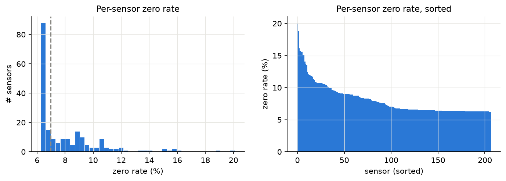
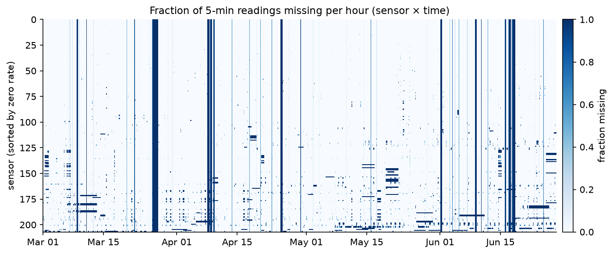
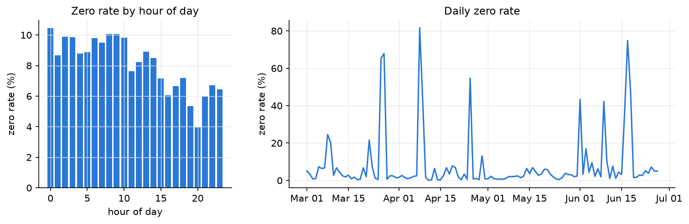

**C. Distribution & artifacts.**
* Nonzero speeds are left-skewed: median **63.2**, mean 58.5, std 13.0 mph. Only 2.9% are below 20 mph, so congestion is the minority regime.
* **Hard cap at 70.0 mph:** nothing exceeds 70, and **33,073** readings (0.51% of nonzero) are exactly 70. This is concentrated in a few sensors: **772669 reads exactly 70 for 25.2%** of its samples, and only 2 sensors exceed 5%.
* **Stuck sensors are rare.** Only 718076 repeats one non-70 value (64.0) for ≥ 3 h (82 steps ≈ 6.8 h), and no sensor is stuck for a day. Constant values are **not** flagged by the zero mask.

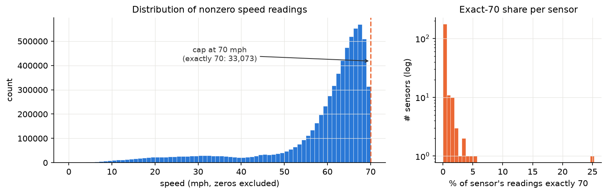

**D. Temporal patterns.** On weekdays the network-mean speed has two rush-hour dips: **AM minimum 48.8 mph at 08:20** and a deeper **PM minimum 44.4 mph at 17:25**, against about 63.7 mph at night. Weekends are flatter (minimum 55.8 mph, midday). Time-of-day and day-of-week are strong, cheap features.

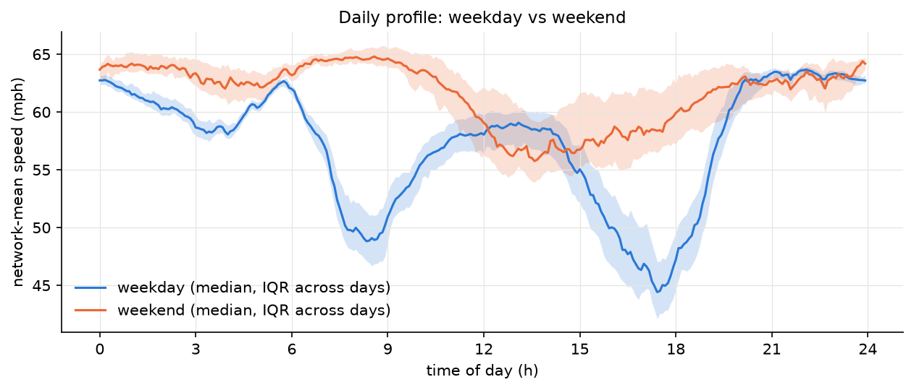
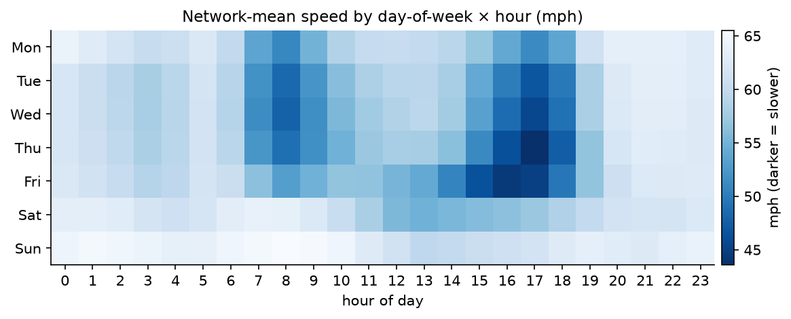
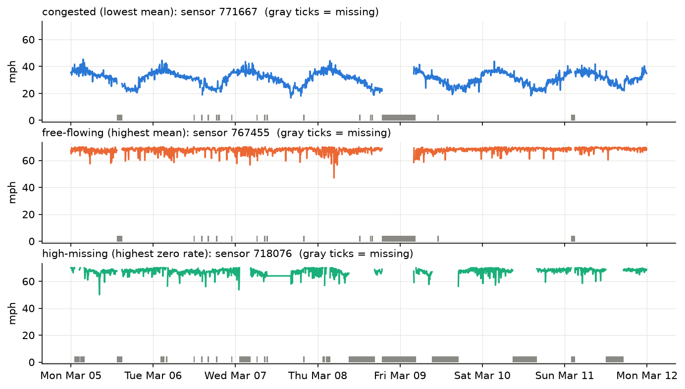

**E. Long-term drift & holidays.** Weekday means are stable month to month (57.0 / 57.6 / 57.3 / 56.7 mph, Mar–Jun), so there's no strong trend. **Memorial Day (2012-05-28, in the validation split) behaves like a weekend:** 64.3 mph vs 58.8 $\pm$ 1.0 on other Mondays. The **test split is slightly slower (57.8 vs 58.6 mph) and has a much higher zero rate (12.1% vs 7.1%)** than train.

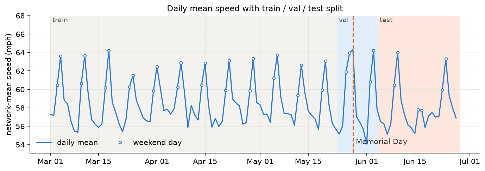

**F. Predictability.** Mean autocorrelation across sensors is **0.86 at 5 min, 0.79 at 15 min, 0.70 at 30 min, 0.57 at 1 h**, and 0.40 at 1 day. Free-flowing sensors are noisy (their ACF drops to about 0.5 after one step). Congested sensors have smooth, strongly periodic ACFs. So persistence is strong at short horizons, and the room for learned models grows with the horizon.

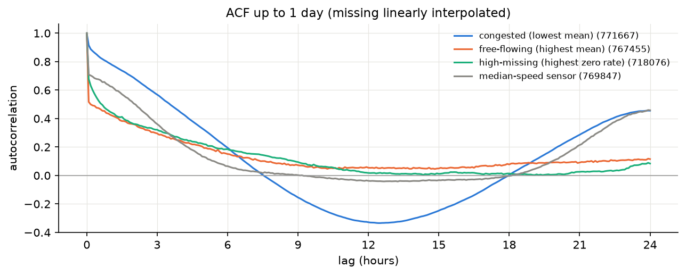
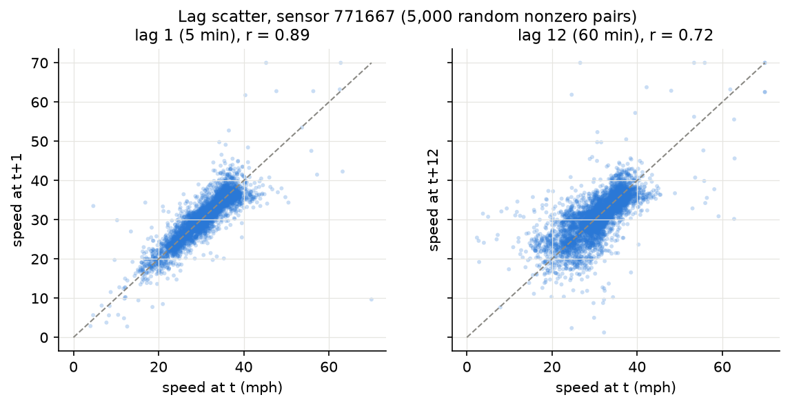

**G. Spatial structure.**
* The adjacency matrix has 1,722 nonzero entries (207 of them self-loops). It is **directed (asymmetric)** and **sparse**: 3.55% off-diagonal density, mean out-degree 7.3, max 18, and one isolated sensor.
* **Linked sensors are much more correlated.** The median raw correlation rises from **0.17** for unlinked pairs to **0.82** for weight > 0.75.
* After removing each sensor's weekly (day-of-week × time-of-day) profile, the residual correlation still rises from **0.05 to 0.65**. Neighbours share *non-periodic* dynamics, which is the signal a graph model can use and a per-sensor model can't.

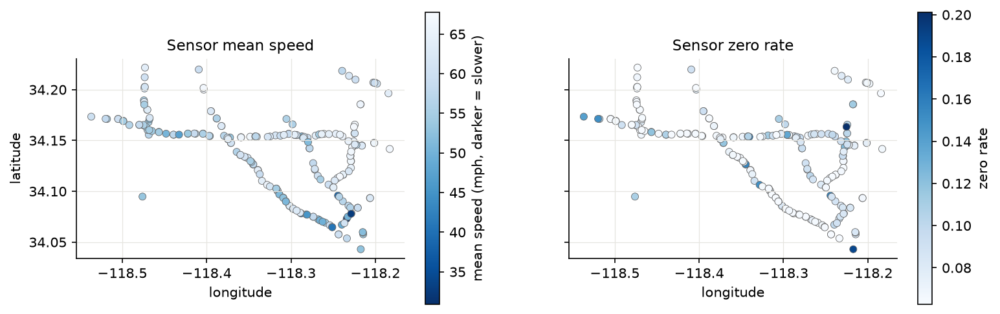
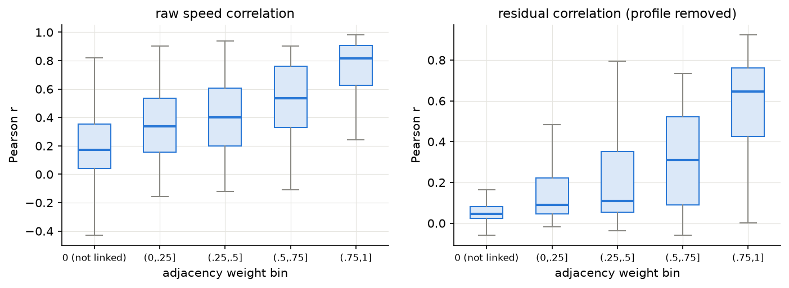

**H. Likely failure modes.**
1. **Outages/imputed zeros:** 6.27% of timestamps are network-wide zeros. Without masking, the loss would reward predicting 0. The test split has more zeros (12.1%) than train. *Mitigation:* masked loss and metrics, mean-fill after normalization, and an optional mask channel.
2. **Post-outage windows:** 8.0% of training windows touch an outage. After a long gap the inputs carry no recent information, so we expect error spikes there.
3. **Sudden congestion onset** (06:00–08:20, 14:30–17:25) is where both probes fail. We expect the largest errors there and the largest gains from spatial (upstream) information.
4. **70-mph cap:** targets are clipped, so error near free-flow is artificially small. Sensor 772669 (25% exactly 70) may be reporting a default value.
5. **Stuck/unreliable sensors** (e.g. 718076: 20.1% missing plus a 6.8-h constant run) aren't masked, so we train and score on fake values.
6. **Non-stationarity/holidays:** Memorial Day falls in validation, which can bias early stopping. The June test period is slightly slower and has more outages than the train split.
7. **Heterogeneous sensors** (31–68 mph means): a global MAE hides per-sensor failures, so we'll report per-sensor error distributions.

---

## 4. Evaluation plan

**Split.** The split is **chronological 70 / 10 / 20 on timestamps**, with no shuffling across time:

| split | start | end | timestamps | 12→12 windows |
|---|---|---|---|---|
| train | 2012-03-01 00:00 | 2012-05-23 07:05 | 23,990 | 23,967 |
| val | 2012-05-23 07:10 | 2012-06-04 04:40 | 3,427 | 3,404 |
| test | 2012-06-04 04:45 | 2012-06-27 23:55 | 6,855 | 6,832 |

We split timestamps **first**, then build sliding 12→12 windows **within** each split, so no window straddles a boundary and there is no leakage. This differs slightly from DCRNN's window-then-split protocol: we drop the 46 windows that would straddle the train/val and val/test boundaries, so split edges differ by a few windows. **Published numbers are therefore approximate reference points, not exact comparisons.** The 70/10/20 ratio matches the DCRNN and Graph WaveNet literature.

**Normalization.** We use a **single global z-score** computed on **nonzero train values only** (mean 58.58, std 12.82 mph), following the DCRNN convention. Per-sensor z-scoring is an option (`zscore_fit(per_sensor=True)`) that we may compare in CI2.

**Missing inputs.** A raw 0 would z-score to **−4.57**, a large fake "congestion" signal (figure below). So:
* We **fill missing inputs with 0 after normalization** (= the train mean).
* The binary observed-mask is always kept and can be appended as an extra input channel (`include_mask_channel=True`).

We will compare with and without the mask channel in CI2. For context, 91.8% of train windows contain at least one missing value somewhere, 10.3% of per-sensor input sequences have a missing step, and 5.48% are fully missing.

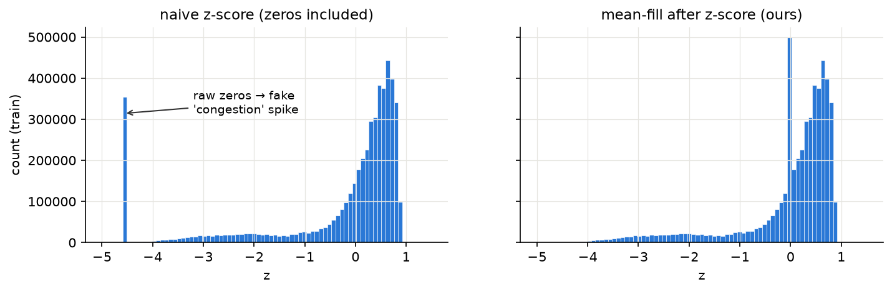

**Inputs.** Per sensor and step: normalized speed, time of day (fraction of day), day of week (0–6), and optionally the mask. All of these are cached in `data/processed/` (`metr_la_processed.npz` + `meta.json`) so CI2 and CI3 train on identical data.

**Metrics** ([`src/metrics.py`](src/metrics.py)). We report **masked MAE, masked RMSE and masked MAPE**. Positions where the ground truth is 0 are excluded; that is 12.1% of test target positions. Metrics are reported at horizons 3/6/12 (15/30/60 min) in raw mph. The same `masked_mae` works on torch tensors and is our training loss. Model selection uses validation masked MAE only. The test set is touched once per final model.

**Non-neural probes (test split, 6,832 windows).**

| model | 15 min MAE | RMSE | MAPE | 30 min MAE | RMSE | MAPE | 60 min MAE | RMSE | MAPE |
|---|---|---|---|---|---|---|---|---|---|
| Persistence (last observed value) | **3.71** | **7.47** | **8.94%** | 4.62 | 9.64 | **11.48%** | 6.14 | 12.61 | 15.69% |
| Historical average (dow × 5-min slot, train) | 4.19 | 7.86 | 13.06% | **4.19** | **7.86** | 13.06% | **4.19** | **7.86** | **13.06%** |

Persistence repeats each sensor's last *nonzero* input value. HA is the train mean of nonzero speed per (sensor, day of week, 5-min slot), so it is independent of horizon. Persistence wins at 15 min but degrades quickly. HA wins from 30 min on. Our HA result (4.19) closely matches the HA reported in the DCRNN paper (4.16), a useful sanity check on the pipeline.

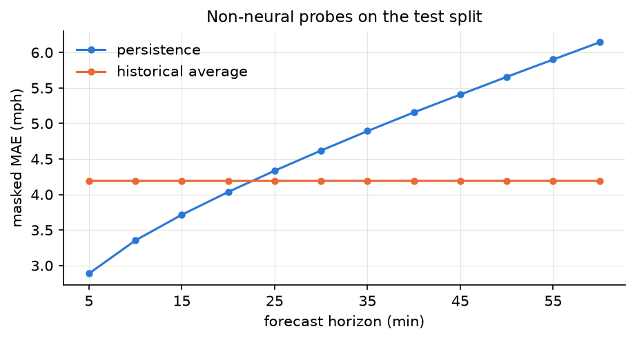

**Reference points (published, METR-LA, MAE at 15 / 30 / 60 min):** FC-LSTM 3.44 / 3.77 / 4.37, DCRNN 2.77 / 3.15 / 3.60 (Li et al., ICLR 2018), and Graph WaveNet 2.69 / 3.07 / 3.53 (Wu et al., IJCAI 2019).

---

## 5. Planned neural approach

**CI2: GRU encoder–decoder (seq2seq), PyTorch.**
* *Design choice:* **per-sensor sequences with shared weights**. Each sensor's 12-step input `[speed_z, tod, dow(, mask)]` is encoded by one GRU, and a GRU decoder emits 12 steps. Batches are reshaped `(B, 12, 207, C) → (B·207, 12, C)`.
* *Alternative considered:* treat all 207 sensors as one 207-dim feature vector per step.
  * Pro: it can learn cross-sensor coupling implicitly.
  * Con: input and output weights scale with N, and it has only ~24k training sequences vs ~5M sensor-sequences with sharing, so it is more prone to overfitting.
  * Con: it doesn't carry over to a graph model.

  We pick **shared weights** because it gives more samples per parameter and is the exact non-graph ablation of a DCRNN-style model. Per-sensor heterogeneity (31–68 mph) can be handled with an optional learnable sensor embedding.
* *Training:* masked MAE loss on raw-mph targets (inverse-transform the outputs), Adam, early stopping on validation MAE, and teacher forcing with scheduled sampling in the decoder. Hidden size and learning rate get a small grid search on validation.

**CI3: graph-based spatio-temporal model (advanced extension).**
* **DCRNN** replaces the GRU's matrix multiplications with diffusion convolutions over the road graph. It uses forward and backward random walks, which matches the directed adjacency found in §3 G. It is also the natural graph extension of the CI2 GRU.
* Alternative, if time allows: **Graph WaveNet** (dilated temporal convolutions + graph convolutions with a learned adaptive adjacency).
* **Ablation:** same architecture, data and training budget, with the real adjacency vs identity (no graph). Optionally also a shuffled-adjacency control. This tests whether the residual spatial correlations in G2 turn into forecast gains, especially at rush-hour onset and long horizons.

---

## References
* Li, Y., Yu, R., Shahabi, C., Liu, Y. *Diffusion Convolutional Recurrent Neural Network: Data-Driven Traffic Forecasting.* ICLR 2018. Code/data: <https://github.com/liyaguang/DCRNN>
* Wu, Z., Pan, S., Long, G., Jiang, J., Zhang, C. *Graph WaveNet for Deep Spatial-Temporal Graph Modeling.* IJCAI 2019.
* Jagadish, H. V. et al. *Big Data and Its Technical Challenges.* Communications of the ACM 57(7), 2014.
