# Project Check-in 2: A Neural Baseline for Traffic Forecasting on METR-LA

DSAN 6600 · Neural Nets & Advanced Deep Learning · Georgetown · Fall 2026

**Team:** Junyoung Kwon/Jason Wang

Every number in this write-up comes either from the executed notebook [`notebooks/02_ci2_results.ipynb`](notebooks/02_ci2_results.ipynb) (which also saves them to [`figures/ci2_numbers.json`](figures/ci2_numbers.json)) or from the run logs in [`logs/`](logs/). All figures are in [`figures/`](figures/).

---

## 1. Problem recap
We want to forecast traffic speed on LA highways. Given the last 12 readings (one hour, at 5-minute resolution) from all 207 loop detectors, the model predicts the next 12 readings (5 to 60 minutes ahead) at every sensor. Like most work on this dataset, we report results at 15, 30 and 60 minutes.

The data handling is exactly the same as in [Check-in 1](../Project_check_in_1/check-in-1.md):
* the data is split chronologically 70/10/20, and windows are cut only after splitting;
* speeds are z-scored with one global mean and std from the nonzero train values (58.58 and 12.82 mph);
* missing inputs are filled with 0 after z-scoring (i.e. the train mean), and a separate mask marks which values were observed;
* MAE, RMSE and MAPE are all masked, so missing targets are left out.

To make sure nothing drifts, we copied the CI1 modules `src/{data,metrics,baselines}.py` over unchanged. The test set has 6,832 windows, covering 2012-06-04 to 06-27.

## 2. Model: a shared-weight GRU with a direct multi-horizon head

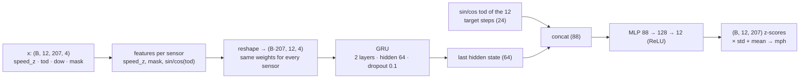

The idea is to treat each sensor's one-hour history as its own sequence and run all of them through the same GRU. The model has no sensor-ID embeddings and no graph, so it doesn't know which sensor it is looking at. This makes it a clean "no-graph" baseline for the ablation we plan in CI3. It has 51,340 parameters in total.

At each time step the GRU sees three things: the normalized speed (0, i.e. the train mean, when missing), the observed mask, and the time of day encoded as sin/cos. We don't give it the day of week.

In CI1 we planned a seq2seq decoder, but we switched to a simpler direct head. We take the GRU's last hidden state, append the sin/cos time of day of the 12 target steps, and an MLP predicts all 12 horizons at once. This avoids exposure bias and the extra tuning that teacher forcing or scheduled sampling would need, and it trains faster. Because the data sits on a regular 5-minute grid, the target times of day follow directly from the last input timestamp.

The model is in [`src/models/gru.py`](src/models/gru.py), training is in [`src/train.py`](src/train.py), and evaluation is in [`src/evaluate.py`](src/evaluate.py).

## 3. Training setup

| setting | value |
|---|---|
| loss | masked MAE in mph (outputs converted back from z-scores; zero targets excluded), `src/metrics.masked_mae` |
| optimizer | Adam, lr 1e-3, weight decay 1e-4 |
| batch | 64 windows (= 13,248 sensor-sequences) |
| gradient clipping | global norm 5 |
| LR schedule | ReduceLROnPlateau on val MAE, factor 0.5, patience 3; the LR was cut twice (final lr 2.5e-4) |
| early stopping | val masked MAE, patience 8, max 40 epochs; it never triggered, so all 40 epochs ran and the best epoch was 40 |
| model | GRU with 2 layers, hidden 64, dropout 0.1, MLP head 128, mask channel on, no day of week |
| data | all 23,967 train windows every epoch (no subsampling), 3,404 val windows |
| seed | 42 |
| hardware | Apple M3 Pro (36 GB), PyTorch 2.14.0 on the MPS backend, Python 3.11.16; we never needed the CPU fallback |
| time | 27.3 s per epoch on average, 18.2 min in total for 40 epochs (a one-epoch timing run beforehand estimated 19.1 min, well inside our 90-min budget) |
| best val masked MAE | **3.249** (2.73 / 3.26 / 3.99 at 15 / 30 / 60 min) |

**Sanity checks.** Before the full run, we tried to make the model memorize a small piece of the training data, with dropout and weight decay turned off (logs in [`logs/`](logs/)):
* On 200 windows, the loss fell from 8.60 to 2.49 mph in 100 steps, and bottomed out at 2.30 after 1,000 steps.
* On a single window (207 sequences), it fell from 8.28 to 0.58 mph in 1,500 steps.

The loss falls steadily in both cases, which tells us the features, targets, masking and gradients are wired up correctly. It doesn't get close to zero on 200 windows, and we think that's expected: those windows hold 41,400 sensor-sequences, and a 51k-parameter model with no idea which sensor it's looking at can't memorize each sensor's noise.

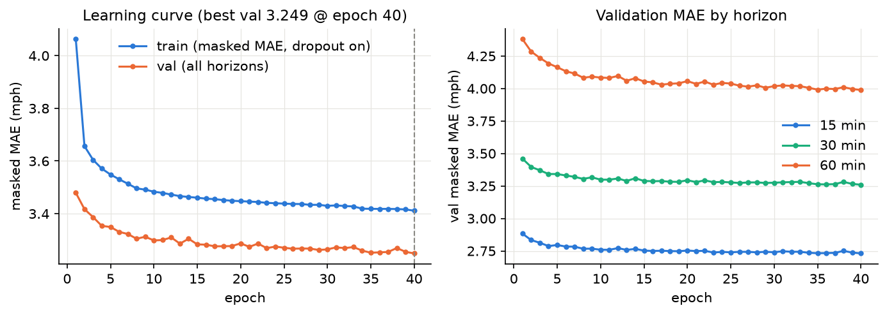

The training loss stays above the validation MAE the whole time (3.41 vs 3.25 at epoch 40). That's mostly because dropout is on during training and the two sets cover different weeks, and it means we see no sign of overfitting. Validation MAE was still inching down at the end (from 3.276 at epoch 17 to 3.249 at epoch 40), so more epochs would gain a few hundredths of a mph at best.

## 4. Results (test split, 6,832 windows)

| model | 15 min MAE | RMSE | MAPE | 30 min MAE | RMSE | MAPE | 60 min MAE | RMSE | MAPE |
|---|---|---|---|---|---|---|---|---|---|
| **GRU (shared-weight, ours)** | **2.99** | **5.89** | **8.03%** | **3.60** | **7.28** | **10.32%** | 4.46 | 8.95 | 13.76% |
| Persistence (last observed) | 3.71 | 7.47 | 8.94% | 4.62 | 9.64 | 11.48% | 6.14 | 12.61 | 15.69% |
| Historical average (dow × 5-min slot, train) | 4.19 | 7.86 | 13.06% | 4.19 | 7.86 | 13.06% | **4.19** | **7.86** | **13.06%** |

Source: [`figures/results_table.csv`](figures/results_table.csv) / [`.md`](figures/results_table.md).

`src/evaluate.py` recomputes both baselines on the same test windows as the GRU, and they match CI1's `probe_results.csv` exactly (max difference 0.000).

*Reference for CI3:* the published test MAE at 15/30/60 min is 2.77/3.15/3.60 for DCRNN (Li et al. 2018) and 2.69/3.07/3.53 for Graph WaveNet (Wu et al. 2019). Those papers window the data before splitting (see CI1 §4), so their numbers aren't directly comparable to ours.

The GRU is the best of the three models at short horizons. Its MAE is 19.4% lower than persistence at 15 min and 14.2% lower than HA at 30 min. At 60 min, though, it falls behind HA by 6.5% (4.46 vs 4.19 MAE, and 8.95 vs 7.86 RMSE). The two curves cross somewhere between 45 min (4.07) and 50 min (4.21).

This makes sense once you look at what HA is: a separate lookup table for every sensor, day of week and time slot. Our GRU doesn't know which sensor it's on or what day it is, so once the last hour stops being informative, it can't fall back on that kind of typical profile (see §6.3).

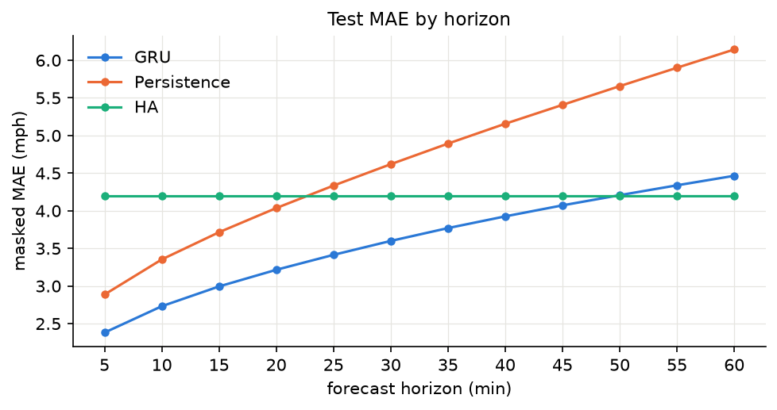

**Congested (target < 40 mph) vs free-flow.** Only 12.4% of test targets are congested, but most of the error comes from them.

| horizon | regime | GRU | Persistence | HA |
|---|---|---|---|---|
| 15 min | congested | 7.45 | **7.34** | 12.90 |
| 15 min | free-flow | **2.37** | 3.20 | 2.96 |
| 30 min | congested | 10.18 | **9.67** | 12.90 |
| 30 min | free-flow | **2.67** | 3.91 | 2.96 |
| 60 min | congested | 14.46 | 13.42 | **12.91** |
| 60 min | free-flow | 3.06 | 5.12 | **2.97** |

At 60 min the GRU's error in congestion (14.46) is 4.7 times its error in free flow (3.06). In congestion it is actually worse than simple persistence at every horizon. Its overall advantage comes from smoothing out noise when traffic is flowing freely.

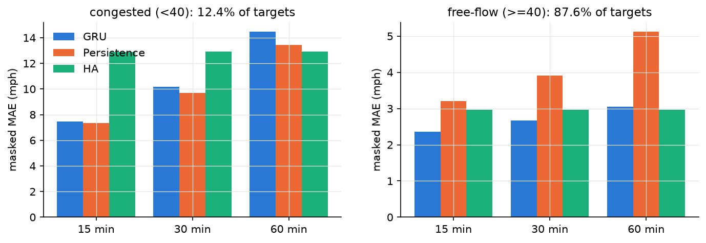

## 5. Qualitative examples
The notebook chooses these cases automatically, using only full weekdays in the test set (details in [`figures/qualitative_cases.csv`](figures/qualitative_cases.csv)). Each figure plots the true speed against the GRU and HA forecasts at the 15-min and 60-min horizons, with every prediction drawn at the time it is predicting.

| case | sensor | day | event | GRU day MAE 15 / 60 min | HA day MAE |
|---|---|---|---|---|---|
| (a) GRU does well (lowest GRU-60 MAE on a congested day) | 718076 | Fri 2012-06-22 | | 1.31 / 1.36 | 1.66 |
| (b) sudden congestion onset (largest 30-min drop) | 716571 | Fri 2012-06-15 | 17:40, 69.3 → 4.0 mph in 30 min | 2.75 / 3.32 | 2.57 |
| (c) right after a network-wide outage | 717461 | Mon 2012-06-18 | outage 21:15 (Sun) → 11:00, 166 steps; first data 11:05 | 7.43 / 13.21 | 20.59 |

**(a)** On a day with real congestion, the GRU follows the true speed closely and does better than HA.
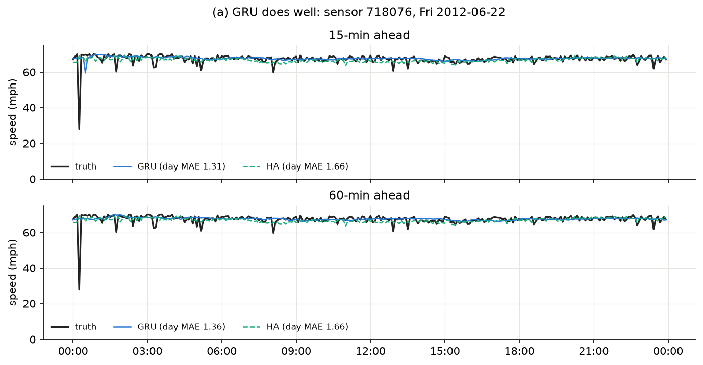

**(b)** The GRU does show the crash, but exactly one horizon late: 15 minutes late at h = 3 and about an hour late at h = 12, by which point the real congestion has already cleared. On this day that makes it worse than HA, which just predicts free flow.
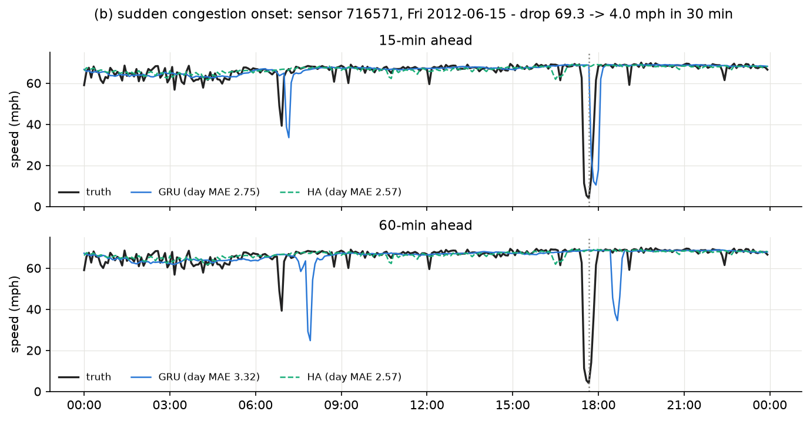

**(c)** This sensor comes back from a 14-hour outage. The first few predictions are made from inputs that are all missing (mean-filled and masked), so they sit near free-flow speed. Once real data arrives, the GRU quickly picks up the unusual congestion that lasts all afternoon (MAE 7.43 vs 20.59 for HA). HA has no way to see what is happening today.
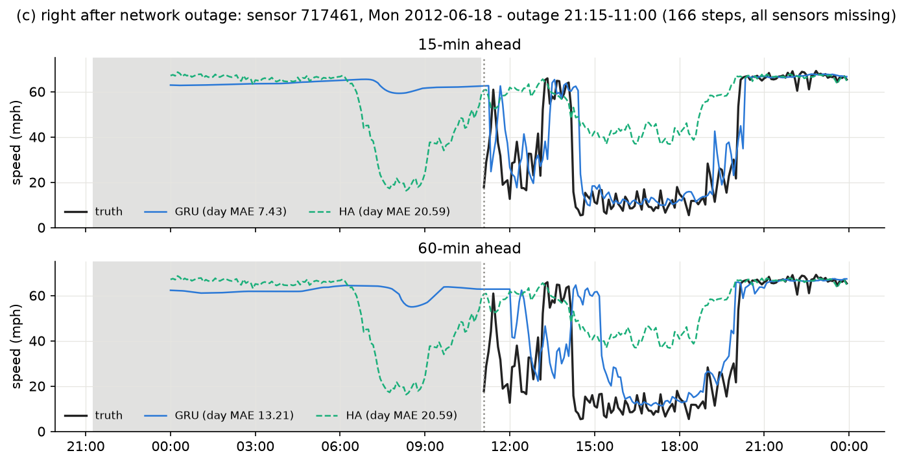

## 6. Failure analysis

### 6.1 Error by time of day, weekday vs weekend
On weekdays, the GRU's 60-min error peaks at 7.56 mph at 16:00, compared with 2.97 overnight (0–4 h). It averages 6.67 during the morning peak (7–9 h) and 7.34 during the evening peak (15–18 h). Weekends are calmer, with a mean of 3.42 against 4.67 on weekdays.

The more telling result is that the 60-min GRU is worse than HA in 14 of the 24 weekday hours, including the hours when rush hour starts (7–8 h and 15–17 h). HA effectively knows from the calendar that traffic slows down at those times, while the GRU only sees the last hour.

The big weekend spikes for persistence come from long weekend outages. When the whole input window is missing, persistence ends up predicting 0.

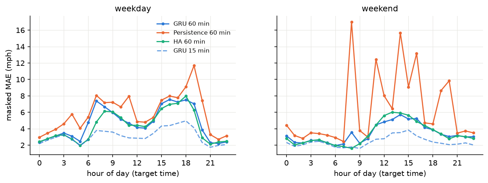

### 6.2 Lag around sharp drops
To see how the model handles sudden slowdowns, we found every point where the true speed fell by more than 15 mph within 30 minutes (with both ends observed), keeping at most one event per sensor per hour. That gives 9,974 events across all 207 sensors. For each event, we measure the lag as the number of 5-minute steps between the truth and the prediction first dropping below the midpoint of the fall.

| model | horizon | median lag (steps) | IQR | never reaches midpoint | MAE in [t₀, t₀+60 min] |
|---|---|---|---|---|---|
| GRU | 15 min | **3** | 3–4 | 25% | 9.57 |
| GRU | 60 min | **12** | 9–13 | 40% | 15.99 |
| Persistence | 15 min | 3 | 3–3 | 2% | 10.00 |
| Persistence | 60 min | 12 | 0–12 | 2% | 16.77 |
| HA | any | 2 | −2–9 | 57% | 11.73 |

The GRU's median lag equals its forecast horizon, just like persistence. In other words, when congestion starts, the model reacts only after the drop shows up in its own inputs; it doesn't see it coming. In 40% of events the 60-min forecast never even gets down to the midpoint, because the model hedges toward the average speed.

One caveat about the averaged plot: the spike in the true speed at −30 min is partly created by how we picked the events (we required a high speed there). The predictions copy that spike, shifted by their horizon.

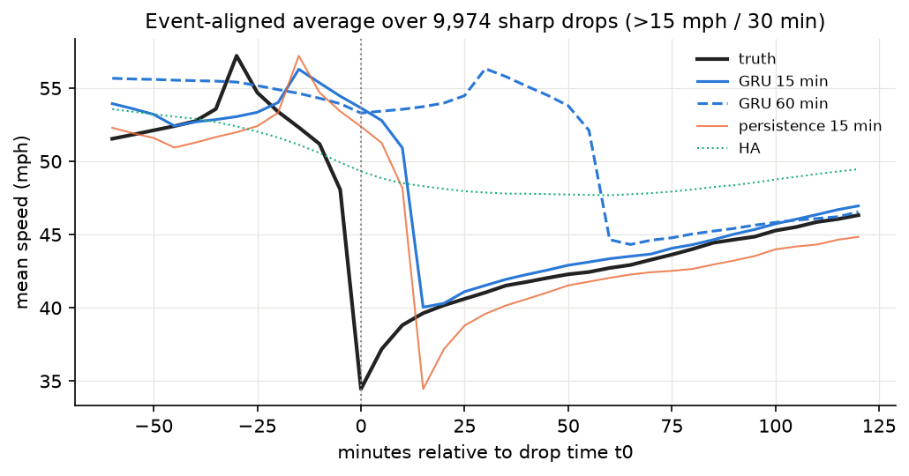

### 6.3 Error vs missing input values
Most of the time the input is complete: 94.3% of 15-min targets come from a sensor with no missing values in its input window, and there the GRU's MAE is 2.94. A few missing steps don't hurt much (3.29 with 1–3 missing up to 3.79 with 7–11 missing, at 15 min).

The problem is when all 12 input steps are missing, which happens for 0.4% of 15-min targets and 1.5% of 60-min targets. The GRU's error then jumps to 8.29 / 8.27 mph, compared with 4.56 / 4.38 for HA. The mask tells the model that the data is missing, but a model that sees one sensor at a time has nothing else to work with: no neighbours and no typical profile for that sensor.

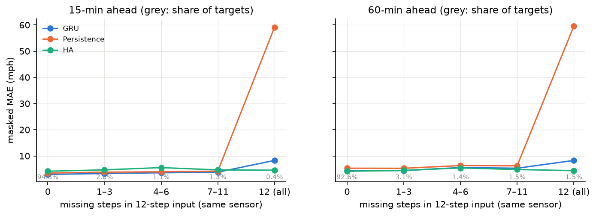

### 6.4 Per-sensor error and the spatial signal
The 60-min error varies a lot between sensors, from 1.30 to 10.08 mph (median 4.21, 90th percentile 7.03). What drives it is mainly how often a sensor is congested: the Spearman correlation with the share of readings under 40 mph is ρ = 0.89, and with mean speed it is −0.81. Missing data barely matters here (ρ = 0.13).

The bad sensors are also clustered. The worst 10 (4.8% of all sensors) account for 10.1% of the total absolute error, and seven of them sit next to each other on the same corridor (717458–717472 and 716339; ranks 1, 3, 4 and 6–9 on the map).

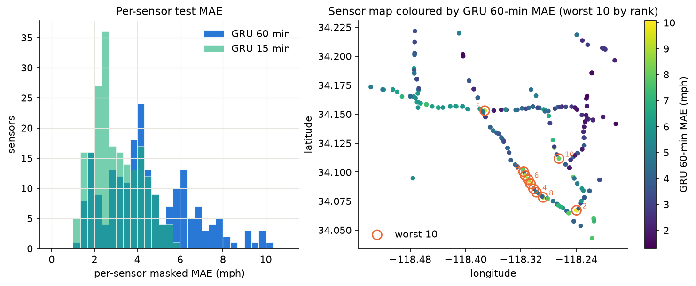

**Do neighbours slow down first?** We looked at 892 large-error events at the worst 10 sensors. These are moments where the 60-min forecast was more than 15 mph too high and the sensor itself dropped by more than 10 mph at some time τ. For each one, we checked which other sensors had already dropped (by more than 10 mph in 30 min) in the 30 minutes before τ. Neighbours come from the DCRNN adjacency matrix (`adj[i, j]` is the edge i→j, threshold 0.1).
* 27% of out-of-i neighbours had already dropped, compared with 14% of sensors that aren't neighbours (1.9 times as often).
* In-neighbours were no more useful than random sensors (12%, 0.8 times).
* At least one neighbour dropped first in 89% of events, compared with 81% for a random set of non-neighbours of the same size.

If the DCRNN edges point in the direction of traffic, "out of i" means downstream, which fits the usual picture of congestion travelling backwards from a bottleneck. Either way, the early warning is there at specific neighbours in the road graph, and a model that looks at one sensor at a time can never use it. This is the main reason we want a graph model with diffusion in both directions next.

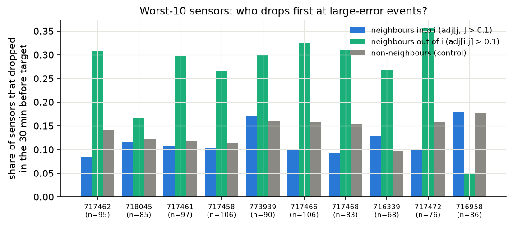

### 6.5 From failure patterns to CI3

| # | failure pattern (evidence) | what we will do in CI3 |
|---|---|---|
| 1 | **Lag equals the horizon when congestion starts**: median lag of 3 / 12 steps at 15 / 60 min, the same as persistence (§6.2, case b). | Use **Graph WaveNet** with forward and backward diffusion over `adj_METR-LA.pkl`. Out-of-i neighbours drop first 1.9 times as often as random sensors (§6.4). |
| 2 | **Worse than persistence in congestion** at every horizon (14.46 vs 13.42 mph at 60 min, §4). | Report congested-regime MAE (and the lag metric from §6.2) as headline metrics when comparing graph vs no-graph. |
| 3 | **Worse than HA at 60 min** (4.46 vs 4.19), because it has no sensor or calendar context (§4, §6.1). | Give both CI3 models day-of-week input and node embeddings. Graph WaveNet's adaptive adjacency already learns node embeddings; giving the no-graph model the same embeddings means the ablation tests only the graph. |
| 4 | **Fully missing inputs** (8.27 vs 4.38 for HA at 60 min, §6.3). | Graph convolutions can borrow from observed neighbours. We will repeat the §6.3 breakdown for the graph model. |
| 5 | **Errors cluster on one congested corridor** (ρ = 0.89 with congestion share; the worst 10 sensors carry 10.1% of the error). | Compare per-sensor MAE maps for graph vs no-graph. If the graph helps, the gains should show up on this corridor. |

## 7. CI3 plan
Our main CI3 model will be **Graph WaveNet**, which combines gated dilated temporal convolutions, diffusion graph convolutions in both directions and an adaptive adjacency matrix. We will train it on exactly the same pipeline as this GRU:
* the same `DATA_DIR`, split, normalization and mask channel;
* the same masked-MAE loss in mph;
* the same early stopping on validation masked MAE;
* the same test windows, scored with `src/evaluate.py`.

If Graph WaveNet turns out to be unstable or too slow to get working in time, we will fall back to DCRNN (a GRU with diffusion convolutions), which is also the most natural graph extension of our current model.

To test whether the graph really helps, we will train three versions with the same architecture and budget: (i) real adjacency plus adaptive adjacency, (ii) adaptive adjacency only, and (iii) no graph at all (identity adjacency). If there is time, we will also try a shuffled adjacency as a control.

The CI3 report will include the same results table as here, plus the congested-regime MAE, the onset lag (§6.2), the all-missing breakdown (§6.3) and the per-sensor map. This GRU stays in the table as our neural baseline.

## 8. Optional extras: seed variance and mask-channel ablation
These runs use the same config and pipeline as the main run. We either changed only the random seed or removed the mask channel (`--no-mask`). The analysis is in §5 of the notebook, and the logs are in [`logs/`](logs/). Every run trained for all 40 epochs and took 18.0–19.6 min.

| run | 15 min MAE | 30 min MAE | 60 min MAE | 60 min RMSE | best val MAE |
|---|---|---|---|---|---|
| seed 42 (main) | 2.994 | 3.599 | 4.465 | 8.948 | 3.249 |
| seed 0 | 2.996 | 3.603 | 4.471 | 8.962 | 3.254 |
| seed 1 | 2.996 | 3.605 | 4.484 | 8.943 | 3.258 |
| seed 2 | 3.000 | 3.608 | 4.472 | 8.936 | 3.255 |
| **mean ± std (4 seeds)** | **2.996 ± 0.002** | **3.604 ± 0.003** | **4.473 ± 0.008** | 8.947 ± 0.011 | 3.254 ± 0.004 |
| no mask channel (seed 42) | 3.016 | 3.629 | 4.498 | 9.018 | 3.266 |

The results barely move between seeds (at most 0.008 mph of MAE), so all the comparisons in §4 hold up, including the GRU losing to HA at 60 min (4.473 ± 0.008 vs 4.19).

Removing the mask channel makes the test MAE a little worse: +0.021, +0.030 and +0.033 at 15, 30 and 60 min. That is 4 to 10 times the seed std, but it comes from a single no-mask run and the effect is small in absolute terms. Mean-filling already fixes most of the "fake congestion" problem from CI1 §4, and the mask adds a little on top of that.

## References
* Li, Y., Yu, R., Shahabi, C., Liu, Y. *Diffusion Convolutional Recurrent Neural Network: Data-Driven Traffic Forecasting.* ICLR 2018.
* Wu, Z., Pan, S., Long, G., Jiang, J., Zhang, C. *Graph WaveNet for Deep Spatial-Temporal Graph Modeling.* IJCAI 2019. METR-LA results in Table 2 (verified against arXiv:1906.00121).
* Jagadish, H. V. et al. *Big Data and Its Technical Challenges.* Communications of the ACM 57(7), 2014.
