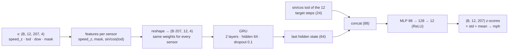

# Project Check-in 2 — Neural Baseline for Spatio-temporal Traffic Forecasting on METR-LA

DSAN 6600 · Neural Nets & Advanced Deep Learning · Georgetown · Fall 2026

**Team:** TODO(Mike): names

All numbers below come from the executed notebook [`notebooks/02_ci2_results.ipynb`](notebooks/02_ci2_results.ipynb) (also dumped to [`figures/ci2_numbers.json`](figures/ci2_numbers.json)) or from the run logs in [`logs/`](logs/). Figures are in [`figures/`](figures/).

---

## 1. Problem recap
* **Task:** from the last **12 steps (1 h)** of speed at all **207** LA highway loop detectors, predict the next **12 steps (5–60 min)** at every sensor. Results are reported at 15 / 30 / 60 min.
* **Data and protocol:** exactly as in [Check-in 1](../Project_check_in_1/check-in-1.md). That means a chronological 70/10/20 split (split first, then window), a global z-score on nonzero train values (mean 58.58, std 12.82 mph), missing inputs filled with 0 after z-scoring plus an observed-mask, and **masked** MAE/RMSE/MAPE with zero targets excluded.
* **Code reuse:** the CI1 modules `src/{data,metrics,baselines}.py` are copied unchanged. Test = 6,832 windows (2012-06-04 → 06-27).

## 2. Model: shared-weight GRU + direct multi-horizon head

* **Per-sensor sequences with shared weights.** Every sensor's 12-step history goes through the same GRU. There are no sensor-ID embeddings and no graph, so the model is sensor-agnostic. It is also exactly the "no-graph" arm of the CI3 ablation. 51,340 parameters.
* **Inputs per step:** normalized speed (missing = 0 = train mean), the observed-mask channel, and time of day as sin/cos. No day-of-week input.
* **Direct multi-horizon head instead of the seq2seq decoder planned in CI1 §5.** The last hidden state, concatenated with sin/cos of the 12 *target* times of day, maps to all 12 horizons in one shot. This avoids exposure bias and teacher-forcing/scheduled-sampling tuning, and is cheaper. The target times of day are computed from the last input timestamp on the regular 5-min grid.
* Code: [`src/models/gru.py`](src/models/gru.py), training in [`src/train.py`](src/train.py), evaluation in [`src/evaluate.py`](src/evaluate.py).

## 3. Training setup

| setting | value |
|---|---|
| loss | masked MAE in **mph** (outputs inverse-transformed; zero targets excluded), `src/metrics.masked_mae` |
| optimizer | Adam, lr 1e-3, weight decay 1e-4 |
| batch | 64 windows (= 13,248 sensor-sequences) |
| gradient clipping | global norm 5 |
| LR schedule | ReduceLROnPlateau on val MAE, factor 0.5, patience 3 → 2 reductions (final lr 2.5e-4) |
| early stopping | val masked MAE, patience 8, max 40 epochs → **did not trigger: 40 / 40 epochs trained, best epoch 40** |
| model | GRU 2 layers, hidden 64, dropout 0.1, MLP head 128, mask channel on, day of week off |
| data | all 23,967 train windows per epoch (no subsampling), 3,404 val windows |
| seed | 42 |
| hardware | Apple M3 Pro (36 GB), PyTorch 2.14.0 **MPS** backend, Python 3.11.16. No MPS fallback was needed. |
| time | 27.3 s / epoch on average, **18.2 min wall clock** for 40 epochs (a pre-run 1-epoch timing projected 19.1 min, well under the 90-min budget) |
| best val masked MAE | **3.249** (15/30/60 min: 2.73 / 3.26 / 3.99) |

**Sanity checks** (logs in [`logs/`](logs/)): we tried to memorize training data with no dropout and no weight decay.
* **200 windows, 100 steps:** loss 8.60 → 2.49 mph. 1,000 steps reached a minimum of 2.30.
* **1 window (207 sequences), 1,500 steps:** loss 8.28 → 0.58 mph.

The loss falls steadily, so the pipeline (features, targets, masking, gradients) is correct. It doesn't reach ≈ 0 on 200 windows because those are 41,400 sensor-sequences going through a 51k-parameter model with no sensor identity. That is by design; this model can't memorize per-sensor noise.

The train loss is computed with dropout on, over a different period, and stays above val MAE (3.41 vs 3.25 at epoch 40). There is no sign of overfitting. Val MAE was still creeping down at epoch 40 (3.276 at epoch 17 → 3.249 at epoch 40), so a longer budget would gain a few hundredths of a mph at most.

## 4. Results (test split, 6,832 windows)

| model | 15 min MAE | RMSE | MAPE | 30 min MAE | RMSE | MAPE | 60 min MAE | RMSE | MAPE |
|---|---|---|---|---|---|---|---|---|---|
| **GRU (shared-weight, ours)** | **2.99** | **5.89** | **8.03%** | **3.60** | **7.28** | **10.32%** | 4.46 | 8.95 | 13.76% |
| Persistence (last observed) | 3.71 | 7.47 | 8.94% | 4.62 | 9.64 | 11.48% | 6.14 | 12.61 | 15.69% |
| Historical average (dow × 5-min slot, train) | 4.19 | 7.86 | 13.06% | 4.19 | 7.86 | 13.06% | **4.19** | **7.86** | **13.06%** |

Source: [`figures/results_table.csv`](figures/results_table.csv) / [`.md`](figures/results_table.md).
* **Baselines:** persistence and HA are recomputed by `src/evaluate.py` on the same test windows and match CI1's `probe_results.csv` exactly (max diff 0.000).
* **Reference for CI3:** published test MAE at 15/30/60 min is 2.77/3.15/3.60 for DCRNN (Li et al. 2018) and 2.69/3.07/3.53 for Graph WaveNet (Wu et al. 2019). They use a different protocol (window-then-split, CI1 §4), so they are not directly comparable.

* The GRU is the **best model at 15 min (19.4% lower MAE than persistence) and 30 min (14.2% lower than HA)**.
* **At 60 min it is 6.5% worse than HA** (4.46 vs 4.19 MAE; 8.95 vs 7.86 RMSE). It crosses HA between 45 min (4.07) and 50 min (4.21).
* HA is a separate lookup per sensor × day-of-week × time slot. A sensor-agnostic model without a day-of-week input cannot reproduce that profile once the last hour stops being informative (§6.3).

**Congested (target < 40 mph) vs free-flow.** Congested targets are 12.4% of the test set but dominate the error.

| horizon | regime | GRU | Persistence | HA |
|---|---|---|---|---|
| 15 min | congested | 7.45 | **7.34** | 12.90 |
| 15 min | free-flow | **2.37** | 3.20 | 2.96 |
| 30 min | congested | 10.18 | **9.67** | 12.90 |
| 30 min | free-flow | **2.67** | 3.91 | 2.96 |
| 60 min | congested | 14.46 | 13.42 | **12.91** |
| 60 min | free-flow | 3.06 | 5.12 | **2.97** |

At 60 min the GRU's error is 4.7× larger in congestion (14.46) than in free flow (3.06). **In congestion it is worse than plain persistence at every horizon.** Its gains come from smoothing free-flow noise.

## 5. Qualitative examples
Cases are selected programmatically on full test weekdays ([`figures/qualitative_cases.csv`](figures/qualitative_cases.csv)). Each figure shows truth vs GRU vs HA at the 15-min and 60-min horizons, with each prediction plotted at its target time.

| case | sensor | day | event | GRU day MAE 15 / 60 min | HA day MAE |
|---|---|---|---|---|---|
| (a) GRU does well (lowest GRU-60 MAE on a congested day) | 718076 | Fri 2012-06-22 | | 1.31 / 1.36 | 1.66 |
| (b) sudden congestion onset (largest 30-min drop) | 716571 | Fri 2012-06-15 | 17:40, 69.3 → 4.0 mph in 30 min | 2.75 / 3.32 | 2.57 |
| (c) right after a network-wide outage | 717461 | Mon 2012-06-18 | outage 21:15 (Sun) → 11:00, 166 steps; first data 11:05 | 7.43 / 13.21 | 20.59 |

**(a)** The GRU tracks a day with real congestion closely and beats HA.

**(b)** The crash appears in the GRU forecast exactly **one horizon late**: 15 min late at h = 3, and about 60 min late at h = 12, after the real congestion has already cleared. That makes it worse than HA, which simply predicts free flow, on this day.

**(c)** After a 14-hour outage, the first predictions come from mean-filled, all-masked inputs and sit near free-flow speed. Once data returns, the GRU locks onto the day's unusual all-afternoon congestion (7.43 vs HA 20.59). HA can't see the current state at all.

## 6. Failure analysis

### 6.1 Error by time of day, weekday vs weekend
On weekdays, the GRU-60 error peaks at **7.56 mph at 16:00**, vs 2.97 overnight (0–4 h). The AM peak (7–9 h) averages 6.67 and the PM peak (15–18 h) 7.34. Weekends are lower and flatter (mean 3.42 vs 4.67).
* GRU-60 is worse than HA in 14 of 24 weekday hours, including the rush-hour onset hours 7–8 h and 15–17 h. HA "knows" recurring congestion from the calendar; the GRU only sees the last hour.
* The weekend spikes in persistence come from the long weekend outages: an all-missing input makes persistence predict 0.

### 6.2 Lag around sharp drops
* **Events:** truth falls > 15 mph within 30 min, both endpoints observed, de-duplicated 1 h apart per sensor. There are 9,974 events at all 207 sensors.
* **Lag:** the delay, in 5-min steps, between the prediction and the truth first falling below the drop's midpoint.

| model | horizon | median lag (steps) | IQR | never reaches midpoint | MAE in [t₀, t₀+60 min] |
|---|---|---|---|---|---|
| GRU | 15 min | **3** | 3–4 | 25% | 9.57 |
| GRU | 60 min | **12** | 9–13 | 40% | 15.99 |
| Persistence | 15 min | 3 | 3–3 | 2% | 10.00 |
| Persistence | 60 min | 12 | 0–12 | 2% | 16.77 |
| HA | any | 2 | −2–9 | 57% | 11.73 |

**The GRU's median lag equals its horizon, the same as persistence.** At congestion onset it reacts to the drop once the drop reaches its own inputs; it does not anticipate it.
* In 40% of events the GRU-60 forecast never gets down to the midpoint, because it hedges toward the mean.
* In the averaged plot, the truth spike at −30 min is partly an artifact of selecting events by a high value there. The predictions inherit that spike, shifted by their horizon.

### 6.3 Error vs missing input values
* 94.3% of 15-min targets have a complete input window for that sensor, with a GRU MAE of 2.94. Partial gaps cost little: 3.29 (1–3 missing steps) to 3.79 (7–11 missing) at 15 min.
* When **all 12 input steps are missing** (0.4% / 1.5% of 15 / 60-min targets), the GRU degrades to **8.29 / 8.27 mph, vs 4.56 / 4.38 for HA**.
* The mask channel tells the model that the data is missing, but a sensor-agnostic model then has nothing to forecast from: no neighbours and no sensor profile.

### 6.4 Per-sensor error and the spatial signal
* **Spread:** per-sensor GRU-60 MAE ranges from 1.30 to 10.08 mph (median 4.21, 90th percentile 7.03).
* **Driver:** it is driven by **how often the sensor is congested** (Spearman ρ = 0.89 with share of readings < 40 mph; −0.81 with mean speed), not by missingness (ρ = 0.13).
* **Clustering:** the worst 10 sensors (4.8% of sensors) carry 10.1% of the absolute error. Seven of them sit next to each other on a single corridor (717458–717472 and 716339; map ranks 1, 3, 4, 6–9).

**Do neighbours drop first?** We looked at the worst-10 sensors' **892 large-error events** (GRU-60 over-predicts by > 15 mph, with the target's own > 10 mph drop at time τ). For each event we asked which sensors had already dropped (> 10 mph in 30 min) in the 30 min before τ. Edges use the DCRNN adjacency (`adj[i, j]` = edge i→j, threshold 0.1):
* **27% of out-of-i neighbours** had already dropped, vs **14% of non-neighbour sensors** (1.9×).
* In-neighbours: 12% (0.8×), no better than random.
* At least one neighbour dropped first in 89% of events, vs 81% for a size-matched random set of non-neighbours.

If DCRNN edges follow traffic flow, "out of i" means downstream, which fits congestion waves travelling backwards from bottlenecks. Either way, **the early-warning signal sits at specific graph neighbours**, and the per-sensor GRU never sees it. This is the direct motivation for a graph model with bidirectional diffusion.

### 6.5 Failure patterns → CI3 next steps

| # | failure pattern (evidence) | CI3 step |
|---|---|---|
| 1 | **Lag = horizon at congestion onset**: median lag 3 / 12 steps at 15 / 60 min, the same as persistence (§6.2, case b). | **Graph WaveNet** with forward + backward diffusion over `adj_METR-LA.pkl`. Out-of-i neighbours drop first 1.9× more often than random sensors (§6.4). |
| 2 | **Worse than persistence in congestion** at all horizons (14.46 vs 13.42 mph at 60 min, §4). | Report congested-regime MAE (and the lag metric of §6.2) as headline CI3 metrics for graph vs no-graph. |
| 3 | **Worse than HA at 60 min** (4.46 vs 4.19); no sensor or calendar context (§4, §6.1). | Give both CI3 arms day-of-week input and node embeddings. Graph WaveNet's adaptive adjacency already learns node embeddings, and the no-graph arm gets the same embeddings, so the ablation isolates the graph. |
| 4 | **Fully missing inputs** (8.27 vs HA 4.38 at 60 min, §6.3). | Graph convolutions can borrow observed neighbours. Re-run the §6.3 breakdown for the graph model. |
| 5 | **Errors cluster on one congested corridor** (ρ = 0.89 with congestion share; worst 10 carry 10.1% of error). | Per-sensor MAE map for graph vs no-graph: gains should concentrate on this corridor if the graph helps. |

## 7. CI3 plan
* **Model:** **Graph WaveNet** (gated dilated temporal convolutions + diffusion graph convolutions with forward/backward transition matrices + an adaptive adjacency), trained on **this exact pipeline**:
  * same `DATA_DIR`, split, normalization and mask channel
  * same masked-MAE loss on mph
  * same early stopping on val masked MAE
  * same test windows, evaluated with `src/evaluate.py`
* **Fallback:** DCRNN (diffusion-convolutional GRU), if Graph WaveNet isn't stable in time. It is also the most direct graph extension of this GRU.
* **Ablation, same architecture and budget:** (i) real adjacency + adaptive, (ii) adaptive only, (iii) **no graph** (identity adjacency). Optionally also a shuffled-adjacency control.
* **Report:** the CI2 table plus congested-regime MAE, onset lag (§6.2), the all-missing breakdown (§6.3) and the per-sensor map. This CI2 GRU stays in the table as the neural baseline.

## 8. Optional extras: seed variance and mask-channel ablation
Same config and pipeline; only the seed changes, or the mask channel is dropped (`--no-mask`). Notebook §5; logs in [`logs/`](logs/). Every run trained all 40 epochs in 18.0–19.6 min.

| run | 15 min MAE | 30 min MAE | 60 min MAE | 60 min RMSE | best val MAE |
|---|---|---|---|---|---|
| seed 42 (main) | 2.994 | 3.599 | 4.465 | 8.948 | 3.249 |
| seed 0 | 2.996 | 3.603 | 4.471 | 8.962 | 3.254 |
| seed 1 | 2.996 | 3.605 | 4.484 | 8.943 | 3.258 |
| seed 2 | 3.000 | 3.608 | 4.472 | 8.936 | 3.255 |
| **mean ± std (4 seeds)** | **2.996 ± 0.002** | **3.604 ± 0.003** | **4.473 ± 0.008** | 8.947 ± 0.011 | 3.254 ± 0.004 |
| no mask channel (seed 42) | 3.016 | 3.629 | 4.498 | 9.018 | 3.266 |

* **Seed variance is tiny** (≤ 0.008 mph MAE), so every comparison in §4 holds across seeds. That includes the GRU being worse than HA at 60 min (4.473 ± 0.008 vs 4.19).
* **The mask channel helps slightly:** removing it raises test MAE by +0.021 / +0.030 / +0.033 at 15 / 30 / 60 min. That is 4–10× the seed std, but it is a single no-mask seed and the effect is small in absolute terms. Mean-filling already removes most of the "fake congestion" problem (CI1 §4); the mask adds a little on top.

## References
* Li, Y., Yu, R., Shahabi, C., Liu, Y. *Diffusion Convolutional Recurrent Neural Network: Data-Driven Traffic Forecasting.* ICLR 2018.
* Wu, Z., Pan, S., Long, G., Jiang, J., Zhang, C. *Graph WaveNet for Deep Spatial-Temporal Graph Modeling.* IJCAI 2019. METR-LA results in Table 2 (verified against arXiv:1906.00121).
* Jagadish, H. V. et al. *Big Data and Its Technical Challenges.* Communications of the ACM 57(7), 2014.
