# Project Check-in 3: Graph WaveNet for Traffic Forecasting on METR-LA

DSAN 6600 · Neural Nets & Advanced Deep Learning · Georgetown · Fall 2026

**Team:** : Mike Kwon, Jason Wang

**Video:** : add vdeio here

Every number in this write-up comes either from the executed notebook [`notebooks/03_ci3_results.ipynb`](notebooks/03_ci3_results.ipynb) (which also saves them to [`figures/ci3_numbers.json`](figures/ci3_numbers.json)) or from the run logs in [`logs/`](logs/). All CI2 numbers are read from CI2's own files. Figures are in [`figures/`](figures/).

**Where each rubric item is answered**

| Rubric item | Section | Figures / tables |
|---|---|---|
| Advanced extension (20) | [§2 Why Graph WaveNet](#2-why-graph-wavenet), [§3 Model](#3-model-graph-wavenet), [§4 Training setup](#4-training-setup) | architecture diagram, `R0_learning_curves.png`, `src/models/gwnet.py` |
| Comparison to CI2 (20) | [§5 Results](#5-results-test-split-6832-windows) | identical / different list, main table, per-horizon delta table, share of sensors, `R1_mae_by_horizon.png`, `R2_congested_vs_free.png`, §5.5 what got worse |
| Ablation (10) | [§6 Ablation](#6-ablation-graph-vs-architecture) | `R3_ablation.png`, `ablation_graph_vs_architecture.csv` |
| Failure analysis (10) | [§7 CI2 failures, before and after](#7-the-ci2-failures-before-and-after), [§8 Where Graph WaveNet still fails](#8-where-graph-wavenet-still-fails) | `FA1`–`FA7`, `Q1`–`Q6`, `qualitative_gwn_failures.csv`, `gwn_worst10.csv` |
| Implications for the final | [§11 Limitations](#11-limitations), [§12 Plan for the final](#12-plan-for-the-final) | |
| Video (10) | link at the top | |

---

## 1. Recap
* **Task.** Forecast speed at 207 LA loop detectors for the next 5 to 60 minutes from the last hour of readings (METR-LA, 5-minute resolution). The problem, data audit and evaluation protocol are in [Check-in 1](../Project_check_in_1/check-in-1.md).
* **CI2.** A shared-weight GRU that sees one sensor at a time reached a test MAE of 2.99 / 3.60 / 4.46 mph at 15 / 30 / 60 min ([Check-in 2](../Project_check_in_2/check-in-2.md)).
* **What CI2 left open.** The GRU lagged behind sudden slowdowns by exactly the forecast horizon and lost to persistence in congestion, while downstream neighbours had often slowed down first.

## 2. Why Graph WaveNet
The CI2 failure analysis showed that the GRU's median lag behind a sharp drop was 3 steps at 15 min and 12 steps at 60 min, the same as persistence: it reacts only once the drop shows up in the sensor's own input ([CI2 §6.2](../Project_check_in_2/check-in-2.md#62-lag-around-sharp-drops)). At the GRU's worst sensors, out-of-i neighbours in the road graph had already dropped 1.9 times as often as unrelated sensors ([CI2 §6.4](../Project_check_in_2/check-in-2.md#64-per-sensor-error-and-the-spatial-signal)), so the warning exists, but a per-sensor model cannot read it. Graph WaveNet (Wu et al., 2019) is the direct answer to that: its graph convolutions pass information along the road graph in both directions at every layer, and it keeps a temporal model (dilated convolutions) that covers the same one-hour input.

## 3. Model: Graph WaveNet
The code is in [`src/models/gwnet.py`](src/models/gwnet.py). It is adapted from the official implementation, [github.com/nnzhan/Graph-WaveNet](https://github.com/nnzhan/Graph-WaveNet) (MIT license, Copyright (c) 2019 Zonghan Wu).

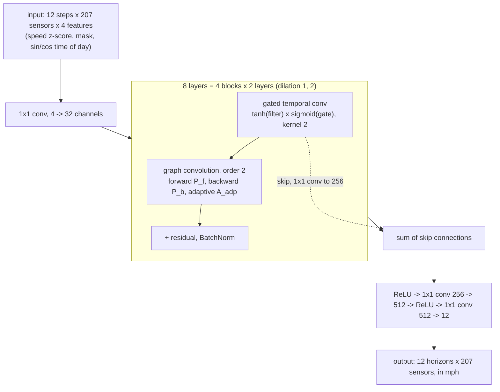

* **Temporal part.** Each layer is a gated convolution over time with kernel size 2. The dilations 1, 2 repeated over 4 blocks give a receptive field of 13 steps, which covers the 12-step input (one zero step is padded on the left, as in the official code).
* **Spatial part.** After each temporal convolution, a diffusion graph convolution of order 2 mixes each sensor's features with those of its neighbours. It uses three matrices: the forward and backward random-walk matrices of the road graph (`adj_METR-LA.pkl`, row-normalized), and an adaptive adjacency `softmax(relu(E1 · E2))` learned from two 207 × 10 embedding tables.
* **Output.** All 12 horizons are predicted in one pass from the summed skip connections, so there is no autoregressive decoding. This matches the direct multi-horizon head of the CI2 GRU.
* **Sizes.** 32 residual channels, 256 skip channels, 512 end channels, dropout 0.3, 301,016 parameters.

**What we changed from the official code**
* Input and output follow our CI2 interface: the model takes the same dataset item as the GRU and returns mph.
* The input features are the same four as the GRU (speed, missing-value mask, sin and cos of time of day). The official code uses speed and time of day.
* One `--graph-mode` flag selects the supports: `fixed+adaptive` (the full model), `fixed`, `adaptive`, or `none`. `none` uses the official code's no-graph branch, a 1 × 1 convolution in place of each graph convolution, so everything else in the network is identical.
* We train with our CI2 loop (`src/train.py`), not the official trainer.

[`scripts/check_gwnet.py`](scripts/check_gwnet.py) checks the output shape for every graph mode and that the adjacency's sensor order matches the data columns. It also checks that in the no-graph model, changing one sensor's input changes only that sensor's output.

## 4. Training setup

| | CI2 GRU | Graph WaveNet (full and no-graph) |
|---|---|---|
| Data, split, windows | METR-LA, chronological 70/10/20, 12 → 12 | same |
| Normalization, missing values | global z-score, mean-fill + mask channel | same |
| Loss | masked MAE in mph | same |
| Optimizer | Adam, lr 1e-3, weight decay 1e-4 | same |
| Batch size, gradient clipping | 64, 5 | same |
| LR schedule | ReduceLROnPlateau (factor 0.5, patience 3) on val MAE | same |
| Early stopping | patience 8 on val MAE | same |
| Seed | 42 | same |
| Dropout | 0.1 | 0.3 (paper's value) |
| Epoch cap | 40 | 48 |
| Hardware | Apple M3 Pro, MPS | same |

**Epoch budget.** The paper trains for 100 epochs. One epoch of the full model takes about two minutes on our laptop, so we capped both runs at 48 epochs to keep the two required runs within about 2.5 hours. The full model did not need the cap: it stopped early at epoch 36 (best epoch 28). The no-graph model used all 48 epochs, but after its best epoch (41, val MAE 3.234) the validation MAE stayed between 3.235 and 3.237, with four learning-rate cuts behind it.

**Checks before the full runs** (logs in [`logs/`](logs/)): on 200 training windows the full model's loss fell from 8.74 to 2.44 mph in 1,000 steps (minimum 2.09), with dropout and weight decay switched off. The CI2 GRU reached 2.86 mph on the same check, so the model and the training loop fit a small set at least as well as before. One epoch took 117.8 s for the full model and 66.7 s without the graph.

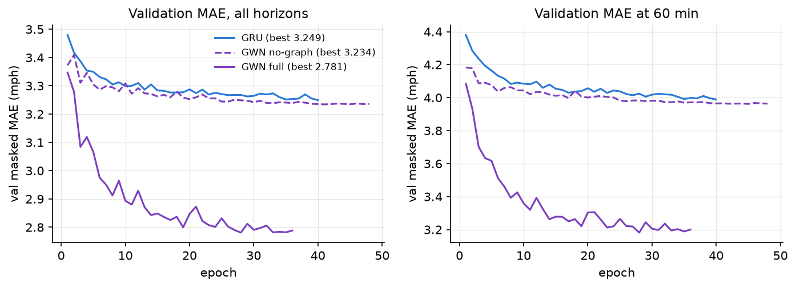

## 5. Results (test split, 6,832 windows)

### 5.1 What is identical and what differs

**Identical to CI2**
* The data files, the chronological split and the 6,832 test windows. The notebook asserts that the targets and window indices in the CI2 and CI3 prediction files are the same arrays.
* Normalization, mean-filling, the mask channel and the four input features.
* The masked MAE / RMSE / MAPE code (`src/metrics.py`, copied unchanged) and the persistence and historical-average baselines.
* Loss, optimizer, learning rate, weight decay, batch size, clipping, LR schedule, early-stopping rule and seed.
* The GRU itself: we did not retrain it. Its numbers come from CI2's saved predictions, and running CI3's evaluation code on the CI2 checkpoint reproduces CI2's test metrics exactly.

**Different**
* The model (Graph WaveNet instead of the GRU), and with it the use of the road graph.
* Dropout 0.3 instead of 0.1, and an epoch cap of 48 instead of 40.

### 5.2 Main table

| model | 15 min MAE | 15 min RMSE | 15 min MAPE (%) | 30 min MAE | 30 min RMSE | 30 min MAPE (%) | 60 min MAE | 60 min RMSE | 60 min MAPE (%) |
|---|---|---|---|---|---|---|---|---|---|
| Persistence | 3.71 | 7.47 | 8.94 | 4.62 | 9.64 | 11.48 | 6.14 | 12.61 | 15.69 |
| HA | 4.19 | 7.86 | 13.06 | 4.19 | 7.86 | 13.06 | 4.19 | 7.86 | 13.06 |
| GRU (CI2) | 2.99 | 5.89 | 8.03 | 3.60 | 7.28 | 10.32 | 4.46 | 8.95 | 13.76 |
| GWN no-graph | 2.98 | 5.91 | 7.92 | 3.58 | 7.30 | 10.22 | 4.44 | 8.98 | 13.71 |
| **GWN full (CI3)** | 2.70 | 5.16 | 7.06 | 3.07 | 6.18 | 8.46 | 3.48 | 7.23 | 9.99 |

Published results, for reference only. Both papers build their windows before splitting and use their own preprocessing ([CI1 §4](../Project_check_in_1/check-in-1.md#4-evaluation-plan)), so these rows are not directly comparable with ours. The values are from Wu et al. 2019, Table 2.

| published (protocol differs) | 15 min MAE | 15 min RMSE | 15 min MAPE (%) | 30 min MAE | 30 min RMSE | 30 min MAPE (%) | 60 min MAE | 60 min RMSE | 60 min MAPE (%) |
|---|---|---|---|---|---|---|---|---|---|
| DCRNN (Li et al. 2018) | 2.77 | 5.38 | 7.30 | 3.15 | 6.45 | 8.80 | 3.60 | 7.60 | 10.50 |
| Graph WaveNet (Wu et al. 2019) | 2.69 | 5.15 | 6.90 | 3.07 | 6.22 | 8.37 | 3.53 | 7.37 | 10.01 |

GWN full beats the GRU on every metric at every horizon. GWN no-graph is within 0.03 mph of the GRU everywhere, so a deeper convolutional architecture on its own buys almost nothing here. Our GWN full is within 0.05 mph of the published Graph WaveNet MAE, which is a useful sanity check on the implementation even though the protocols differ.

### 5.3 Per-horizon delta (GWN full − GRU)

| horizon (min) | GRU | GWN no-graph | GWN full | GWN full - GRU | % change |
|---|---|---|---|---|---|
| 5 | 2.381 | 2.370 | 2.235 | -0.146 | -6.1% |
| 10 | 2.732 | 2.722 | 2.511 | -0.221 | -8.1% |
| 15 | 2.994 | 2.982 | 2.697 | -0.298 | -9.9% |
| 20 | 3.216 | 3.203 | 2.846 | -0.370 | -11.5% |
| 25 | 3.414 | 3.399 | 2.965 | -0.449 | -13.2% |
| 30 | 3.599 | 3.584 | 3.069 | -0.530 | -14.7% |
| 35 | 3.770 | 3.752 | 3.158 | -0.612 | -16.2% |
| 40 | 3.926 | 3.908 | 3.237 | -0.688 | -17.5% |
| 45 | 4.072 | 4.051 | 3.306 | -0.766 | -18.8% |
| 50 | 4.207 | 4.186 | 3.367 | -0.841 | -20.0% |
| 55 | 4.338 | 4.315 | 3.422 | -0.916 | -21.1% |
| 60 | 4.465 | 4.438 | 3.480 | -0.985 | -22.1% |

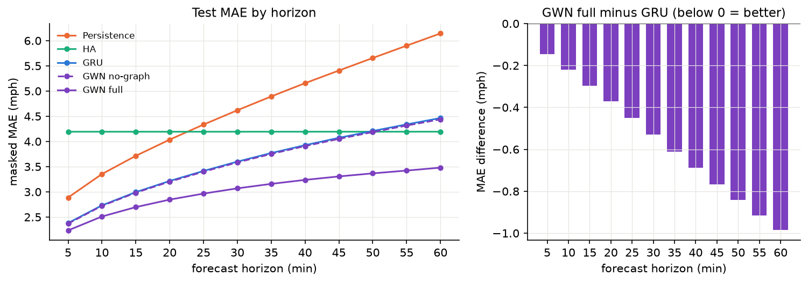

The gap grows steadily with the horizon, from 0.15 mph (6%) at 5 min to 0.99 mph (22%) at 60 min. This is what we would expect if the gain comes from other sensors: at 5 min a sensor's own last reading says almost everything, while at 60 min the traffic that will arrive is still somewhere else on the network. GWN full stays below the historical average at all 12 horizons, while the GRU crossed above it after 45 min.

### 5.4 Share of sensors where Graph WaveNet beats the GRU

| horizon | GWN full beats GRU | GWN no-graph beats GRU | GWN full beats GWN no-graph | median change (mph) | largest gain (mph) | largest loss (mph) |
|---|---|---|---|---|---|---|
| 15 min | 99.5% | 74.4% | 99.5% | -0.26 | -1.21 | 0.03 |
| 30 min | 99.5% | 68.6% | 99.5% | -0.49 | -1.99 | 0.00 |
| 60 min | 100.0% | 74.9% | 100.0% | -0.93 | -3.74 | -0.05 |

The improvement is not driven by a few sensors. GWN full has a lower MAE than the GRU at 99.5% of the 207 sensors at 15 and 30 min and at all of them at 60 min. The one sensor that gets worse at 15 min loses 0.03 mph.

### 5.5 Congested vs free-flow, and what got worse

| horizon | regime | share of targets | Persistence | HA | GRU | GWN no-graph | GWN full |
|---|---|---|---|---|---|---|---|
| 15 min | congested (<40) | 12.4% | 7.34 | 12.90 | 7.45 | 7.35 | 6.36 |
| 15 min | free-flow (>=40) | 87.6% | 3.20 | 2.96 | 2.37 | 2.37 | 2.18 |
| 30 min | congested (<40) | 12.4% | 9.67 | 12.90 | 10.18 | 10.09 | 7.97 |
| 30 min | free-flow (>=40) | 87.6% | 3.90 | 2.96 | 2.67 | 2.67 | 2.38 |
| 60 min | congested (<40) | 12.4% | 13.42 | 12.90 | 14.46 | 14.46 | 9.70 |
| 60 min | free-flow (>=40) | 87.6% | 5.12 | 2.96 | 3.06 | 3.02 | 2.60 |

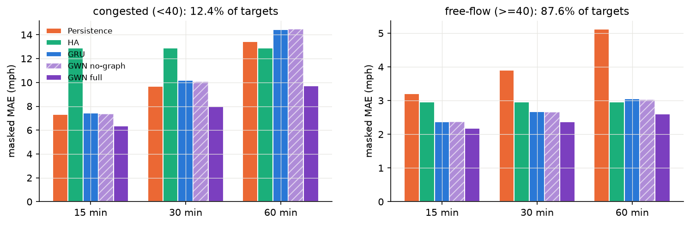

In CI2 the GRU lost to plain persistence in congestion at every horizon. GWN full now beats persistence at all three, and it cuts the 60-min congested MAE from 14.46 to 9.70 mph. Congested targets are 12.4% of the test set and their error is still 3.7 times the free-flow error, so congestion remains the hard regime.

**What got worse**
* **Cost.** Training takes 3.9 times as long as the GRU (70.5 vs 18.2 min), inference 2.8 times (10.7 vs 3.8 s for the whole test set), and the model has 5.9 times as many parameters (§10).
* **Short drops are ignored more often.** GWN full never follows 48% of sharp drops at 60 min, against 40% for the GRU (§7.2).
* **False alarms from neighbours.** The graph can announce a slowdown too early (§8.1, case e).
* **Whole-network outages.** When every sensor is missing, GWN full is slightly worse than its own no-graph version, 7.74 vs 7.33 mph (§7.3).
* **Portability.** The adaptive adjacency ties the trained model to these 207 sensors (§11).
* No aggregate metric got worse. For GWN no-graph, the RMSE is 0.02 to 0.03 mph worse than the GRU's at all three horizons.

## 6. Ablation: graph vs architecture
`gwnet_nograph` is the same network as `gwnet_full` with every graph convolution replaced by a 1 × 1 convolution, so no information moves between sensors. Everything else is the same. We split the total gain over the GRU into two steps: GRU → GWN no-graph is the architecture, and GWN no-graph → GWN full is the graph.

| slice | GRU | GWN no-graph | GWN full | total gain | from architecture | from graph | graph share of gain |
|---|---|---|---|---|---|---|---|
| all horizons | 3.593 | 3.576 | 3.024 | 0.568 | 0.017 | 0.551 | 97% |
| 15 min | 2.994 | 2.982 | 2.697 | 0.298 | 0.012 | 0.286 | 96% |
| 30 min | 3.599 | 3.584 | 3.069 | 0.530 | 0.015 | 0.515 | 97% |
| 60 min | 4.465 | 4.438 | 3.480 | 0.985 | 0.027 | 0.958 | 97% |
| 15 min, congested | 7.448 | 7.350 | 6.364 | 1.084 | 0.098 | 0.986 | 91% |
| 30 min, congested | 10.182 | 10.085 | 7.975 | 2.208 | 0.097 | 2.111 | 96% |
| 60 min, congested | 14.456 | 14.461 | 9.704 | 4.752 | -0.005 | 4.757 | 100% |
| 15 min, free-flow | 2.366 | 2.366 | 2.179 | 0.187 | 0.000 | 0.187 | 100% |
| 30 min, free-flow | 2.670 | 2.666 | 2.377 | 0.293 | 0.004 | 0.290 | 99% |
| 60 min, free-flow | 3.056 | 3.024 | 2.602 | 0.453 | 0.031 | 0.422 | 93% |

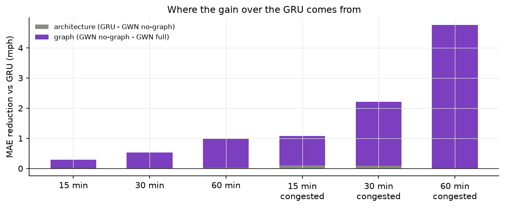

Over all horizons the total gain is 0.568 mph. The architecture accounts for 0.017 mph of it and the graph for 0.551 mph (97%). The split looks the same in every slice (91% to 100% graph). In 60-min congestion the architecture contributes nothing (−0.005) and the graph contributes 4.76 mph.

Our reading is that a model which only sees one sensor's history hits the same ceiling whether it is a GRU or a dilated CNN five times its size: the two models' errors on the test set have a correlation of 0.99. What moves the number is letting sensors see each other.

Two cautions. This is one seed per model; the four GRU seeds in CI2 differed by 0.002 to 0.008 mph, so the 0.017 mph architecture effect is at the edge of seed noise, while the graph effect is about 70 times larger. And "graph" here means the fixed road graph and the adaptive adjacency together. We did not have time to train the `fixed` and `adaptive` variants, so we cannot separate them (§9).

## 7. The CI2 failures, before and after
Each analysis uses the same definitions and the same events as the CI2 notebook. The notebook asserts that it reproduces CI2's counts (for example the 9,974 sharp-drop events).

### 7.1 Error by time of day
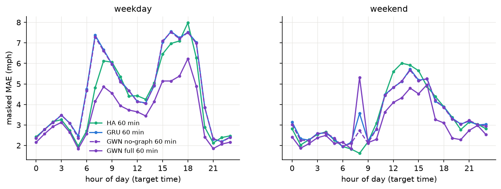

At 60 min the GRU's weekday error peaked in the rush hours (6.67 mph at 7–9 h, 7.34 mph at 15–18 h), and it was worse than the historical average in 14 of 24 weekday hours. GWN full brings those two to 4.52 and 5.47 mph and is not worse than the historical average in any weekday hour. The gain is largest right at congestion onset (3.23 mph at 7 h, 2.41 mph at 16 h) and smallest at night (about 0.2 mph), when there is nothing to propagate. The rush hours are still its worst hours.

### 7.2 Lag around sharp drops

| model | horizon (min) | never crosses | median lag (steps) | IQR | crosses with lag < horizon (all events) | MAE in [t0, t0+60] |
|---|---|---|---|---|---|---|
| Persistence | 15 | 2% | 3 | 3 to 3 | 12% | 10.00 |
| Persistence | 60 | 2% | 12 | 0 to 12 | 35% | 16.77 |
| GRU | 15 | 25% | 3 | 3 to 4 | 7% | 9.57 |
| GRU | 60 | 40% | 12 | 9 to 13 | 20% | 15.99 |
| GWN full | 15 | 36% | 3 | 1 to 4 | 27% | 7.87 |
| GWN full | 60 | 48% | 4 | -1 to 11 | 40% | 11.14 |

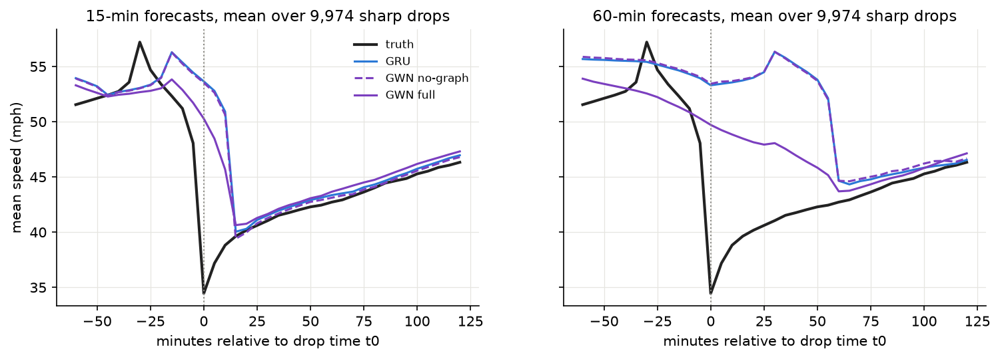

The lag is the number of 5-minute steps between the truth and the forecast first falling below the midpoint of the drop. At 60 min the GRU's median lag was 12 steps, the horizon itself. For GWN full it is 4 steps. Counting all 9,974 events, GWN full crosses the midpoint with a lag shorter than the horizon in 40% of them, against 20% for the GRU, and the error in the hour after the drop falls from 15.99 to 11.14 mph.

One thing got worse. GWN full never follows the drop at all in 48% of events at 60 min (GRU 40%) and in 36% at 15 min (GRU 25%). The median lag only covers the events a model does follow, so on its own it flatters the model. The drops GWN full ignores are mostly brief: the truth stays below the midpoint for a median of 3 of the 13 steps after the drop, against 9 for the drops it follows. That fits a model that averages over neighbours and so smooths away a short dip at a single sensor.

### 7.3 Missing input values (60-min horizon)

| missing input steps | share of targets | Persistence | HA | GRU | GWN no-graph | GWN full |
|---|---|---|---|---|---|---|
| 0 | 92.6% | 5.31 | 4.15 | 4.38 | 4.35 | 3.38 |
| 1-3 | 3.1% | 5.28 | 4.46 | 4.42 | 4.39 | 3.48 |
| 4-6 | 1.4% | 6.32 | 5.42 | 5.56 | 5.57 | 4.43 |
| 7-11 | 1.5% | 6.21 | 4.81 | 5.30 | 5.42 | 4.62 |
| 12 (all) | 1.5% | 59.54 | 4.38 | 8.28 | 7.82 | 7.48 |

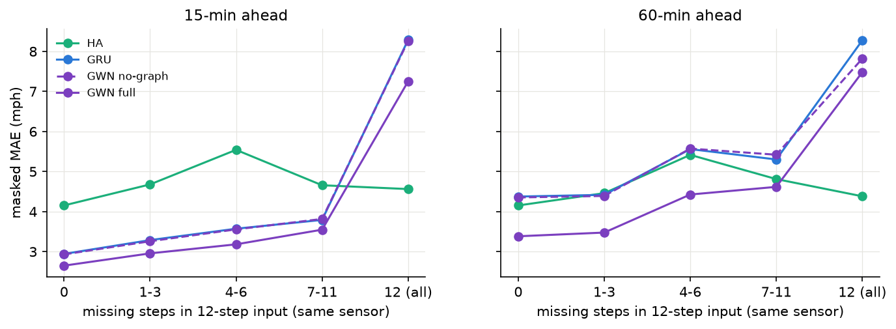

GWN full is better than the GRU in every bin, but the gain shrinks as more of the input is missing (0.99 mph with a complete window, 0.80 mph when all 12 steps are missing). Splitting the all-missing case shows what the graph can and cannot do:

* When the sensor's own inputs are all missing but other sensors are reporting (2,751 targets), the graph fills the gap from the neighbours: 5.99 mph, against 10.60 without the graph and 10.54 for the GRU.
* When more than 90% of the network is down (15,665 targets) there is nothing to read. GWN full (7.74 mph) is then slightly worse than GWN no-graph (7.33), and all three neural models lose badly to the historical average (4.18).

### 7.4 Per-sensor error and the CI2 worst 10 sensors
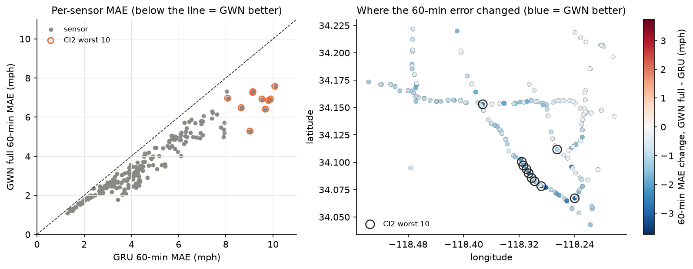

All ten of the GRU's worst sensors improve. Their mean 60-min MAE falls from 9.30 to 6.80 mph, a gain of 2.51 mph against 0.91 mph at the other 197 sensors (table in [`ci2_worst10_before_after.csv`](figures/ci2_worst10_before_after.csv)). Two cautions. These sensors were picked for having the largest GRU error, so part of the extra gain is selection. And the ranking barely changes: per-sensor error still tracks how often the sensor is congested (Spearman 0.81 for GWN full, 0.89 for the GRU), and these ten still carry 9.4% of the total absolute error (10.1% before).

### 7.5 The CI2 neighbour-lead events
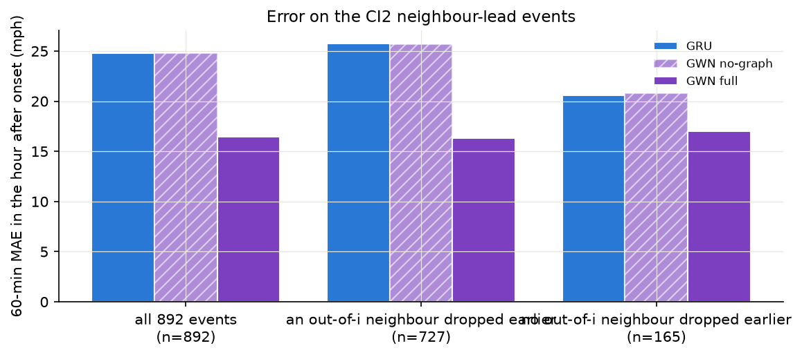

CI2 found 892 moments at its worst 10 sensors where the GRU's 60-min forecast was more than 15 mph too high. On those events the GRU's error is 24.79 mph and GWN full's is 16.47 mph. The events were selected for large GRU error, so GRU vs GWN is not a fair test. The fair one is GWN full vs GWN no-graph, since neither was used to pick the events: the graph removes 8.31 mph (95% bootstrap CI 7.50 to 9.17) and helps in 78% of the events.

The effect is larger when a neighbour had already dropped (−8.71 mph, 796 events) than when none had (−4.97 mph, 96 events). That supports the CI2 hypothesis that neighbours carry an early warning. It is not the whole story, because the graph still helps when no direct neighbour had dropped, and 16.47 mph is still a very large error.

### 7.6 The three CI2 example days

| CI2 case | sensor, day | GRU 60-min MAE | GWN full 60-min MAE |
|---|---|---|---|
| (a) GRU does well | 718076, Fri 2012-06-22 | 1.36 | 1.33 |
| (b) sudden congestion onset | 716571, Fri 2012-06-15 | 3.32 | 2.64 |
| (c) right after the network outage | 717461, Mon 2012-06-18 | 13.21 | 8.38 |

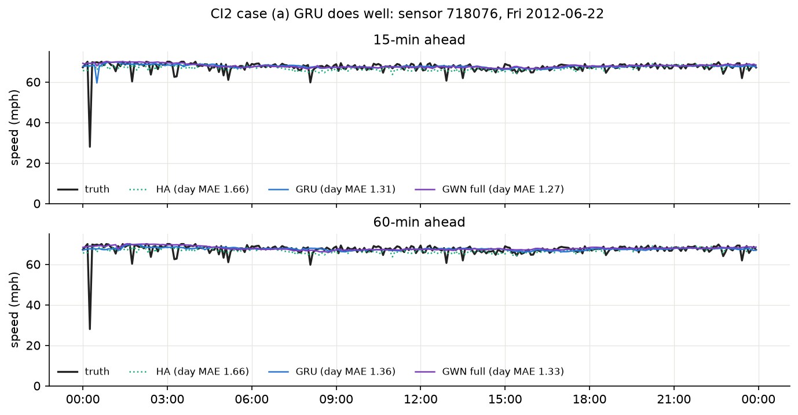
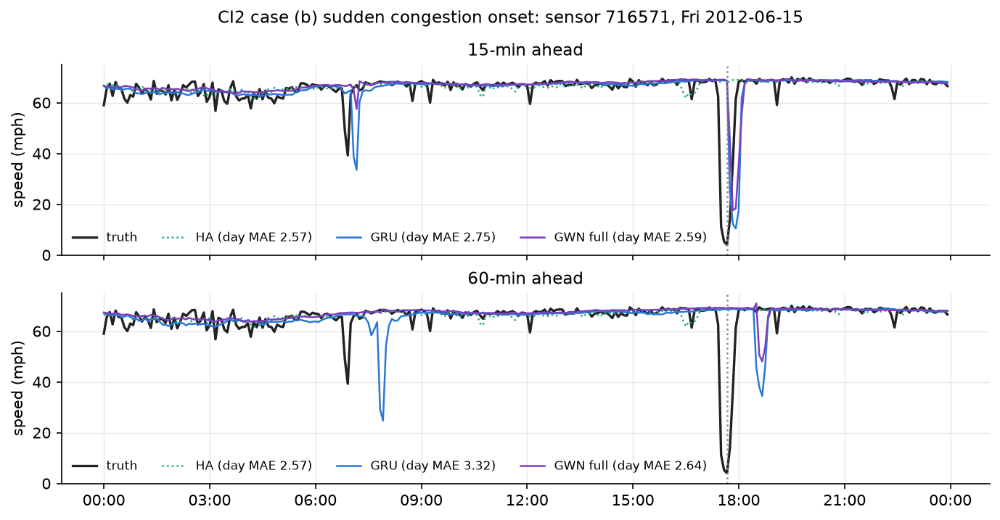
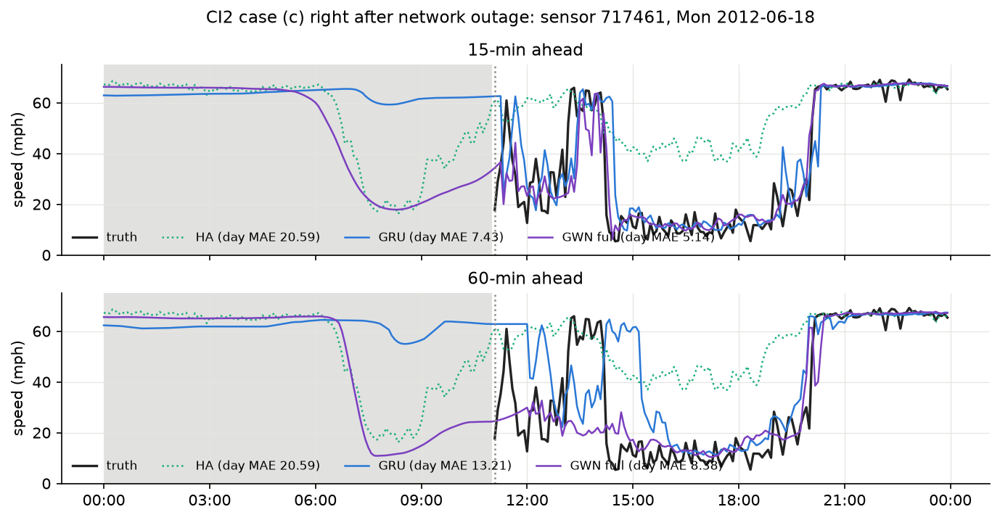

On the easy day the two models are the same. On the congestion-onset day GWN full is better over the day but still misses the single sharpest drop, which comes back as case (f) below. The biggest change is the day after the outage, where the graph lets the model recover from sensors that are already reporting.

## 8. Where Graph WaveNet still fails

### 8.1 Three new cases, selected by code
The notebook picks these from GWN full's own errors on full test weekdays (sensor-days that are at least 90% observed). The selection code and the full table are in notebook §7.1 and [`qualitative_gwn_failures.csv`](figures/qualitative_gwn_failures.csv).

| Case | Selection rule | Sensor | Timestamp | Truth / GWN / GRU (mph) | Day MAE at 60 min, GWN vs GRU |
|---|---|---|---|---|---|
| (d) | highest GWN full 60-min MAE over a sensor-day | 716960 | Wed 2012-06-13 14:20 | 7.9 / 62.2 / 21.4 | 12.82 vs 11.08 |
| (e) | sensor-day where GWN full is worse than the GRU by most | 773012 | Tue 2012-06-26 07:10 | 62.5 / 22.2 / 63.7 | 8.14 vs 5.13 |
| (f) | largest single GWN full 60-min error | 716571 | Fri 2012-06-15 17:40 | 4.0 / 69.0 / 68.8 | 2.64 vs 3.32 |

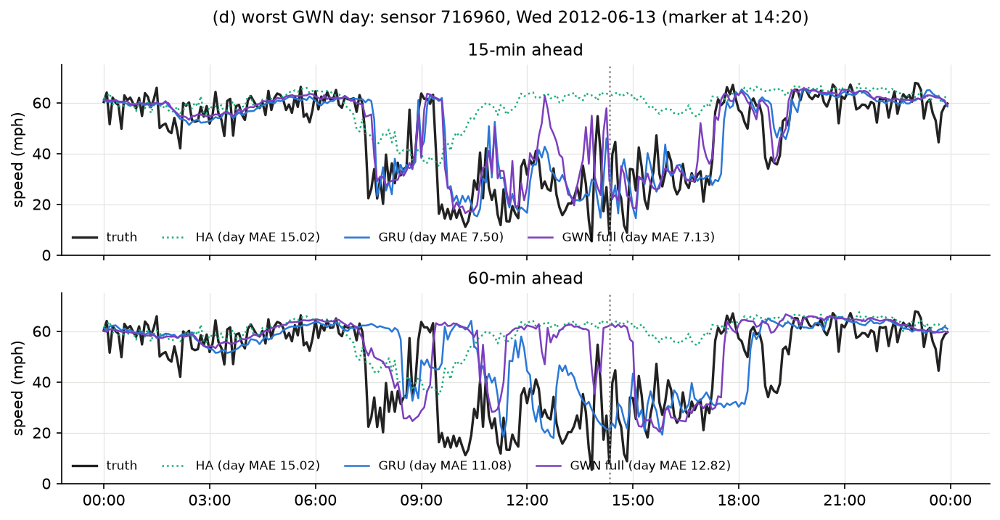

**(d) Long, unusual congestion.** The sensor sits in congestion from mid-morning to late afternoon on a day when the historical average says about 60 mph. GWN full's 60-min forecast keeps jumping back to about 62 mph. The GRU mostly copies its own recent input, and that works better here.

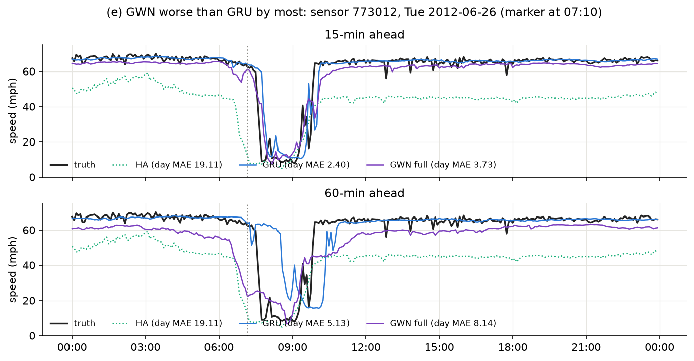

**(e) A false alarm from the graph.** GWN full predicts the morning breakdown about half an hour too early. At 07:10 it says 22.2 mph while the sensor is still at 62.5, at a moment when a neighbour is already down to 31.2 mph. It then stays about 5 mph too low for the rest of the day. The neighbours' congestion is real, but the timing at this sensor is wrong.

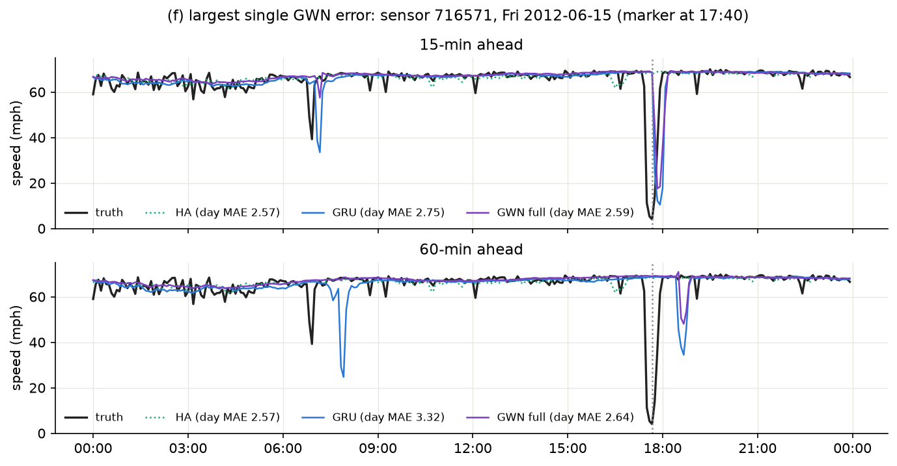

**(f) A collapse with no warning in the sensor's own data.** The truth is 4.0 mph and both models predict about 69. This sensor is congested in only 0.2% of the test set and its own input never went below 61 mph. One neighbour was already slow (5.2 mph), and the model did not act on it.

### 8.2 The pattern in the largest errors
The top 1% of GWN full's 60-min errors (above 35.5 mph) carry 12.4% of its total absolute error. Compared with all targets:

| Condition | Share of top 1% errors | Share of all targets |
|---|---|---|
| target is congested (< 40 mph) | 70% | 12% |
| truth at least 20 mph below the historical average | 63% | 3% |
| a sharp drop in the hour before | 67% | 12% |
| GWN over-predicts (a missed slowdown) | 70% | 51% |
| the GRU's error is also in its own top 1% | 43% | 1% |

So the failure that remains is the unusual slowdown: congestion at a time or place where it does not normally happen, which the model predicts too late or not at all. A large part of the hard cases is shared with the GRU.

For congested targets after a sharp drop, the error depends on what the model could see ([`gwn_drop_visibility.csv`](figures/gwn_drop_visibility.csv)). If the sensor's own input was already slow, GWN full's 60-min error is 10.84 mph. If the sensor's own input was still fast, it is 17 to 18 mph, even though this is where the graph helps most (13.6 to 16.4 mph better than no-graph). We expected the graph to help only when a direct neighbour was already slow. It helps just as much when none was, so the "one-hop neighbour drops first" picture from CI2 is too narrow. The model can reach much further than one hop, through 8 graph layers of order 2 and the adaptive adjacency.

### 8.3 Do the worst sensors have low graph degree?
No. GWN full's ten worst sensors at 60 min:

| sensor_id | GWN full 60 | GRU 60 | share <40 mph | in-degree | out-degree |
|---|---|---|---|---|---|
| 717462 | 7.58 | 10.08 | 0.40 | 14 | 13 |
| 716960 | 7.32 | 8.03 | 0.20 | 3 | 6 |
| 717466 | 7.30 | 9.15 | 0.32 | 14 | 11 |
| 717468 | 7.26 | 9.14 | 0.28 | 14 | 14 |
| 716958 | 6.97 | 8.08 | 0.25 | 5 | 8 |
| 718045 | 6.93 | 9.91 | 0.30 | 6 | 14 |
| 773939 | 6.92 | 9.53 | 0.25 | 3 | 3 |
| 717461 | 6.85 | 9.81 | 0.48 | 17 | 11 |
| 717472 | 6.48 | 8.65 | 0.25 | 10 | 12 |
| 717458 | 6.41 | 9.68 | 0.50 | 13 | 15 |

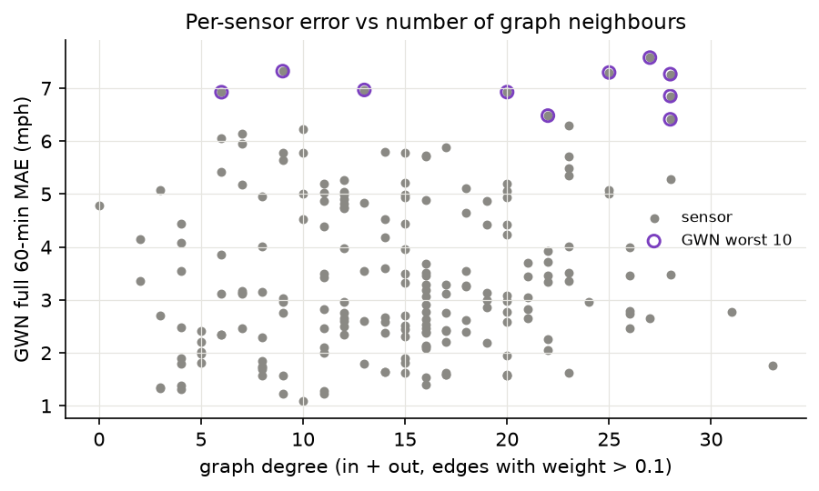

Their median total degree is 23.5, against 15 for all sensors, and across sensors the 60-min MAE barely correlates with degree (Spearman 0.14). Nine of the ten were already in the GRU's worst ten. What they share is congestion (20% to 50% of their targets are below 40 mph), not isolation.

Degree does seem to matter for the size of the gain. The graph is worth 1.40 mph in the highest-degree quarter of sensors and 0.71 mph in the lowest (Spearman −0.40 between degree and the graph effect). High-degree sensors are also the more congested ones (22% vs 8% of targets below 40 mph), so we cannot separate the two explanations here.

### 8.4 Error by test day
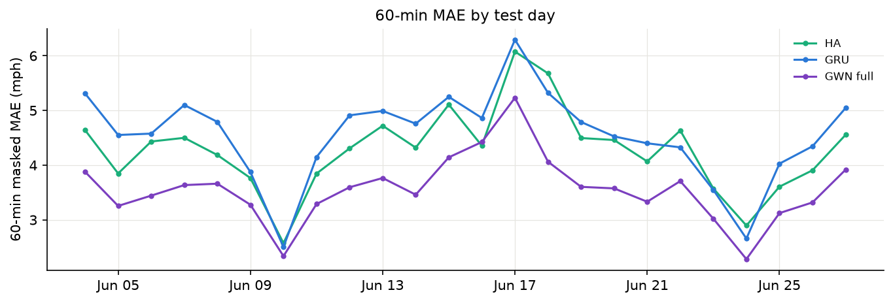

GWN full is better than the GRU on all 24 test days. Its worst day is Sunday 2012-06-17 (5.23 mph), when only 25% of the targets were observed because of the network outage, and on Saturday 2012-06-16 it is slightly worse than the historical average (4.42 vs 4.35). Its error is a little higher in the second half of the test period (3.63 vs 3.48), but the historical average moves the same way (4.36 vs 4.19), so this looks like harder days and not drift.

## 9. What the adaptive adjacency learned
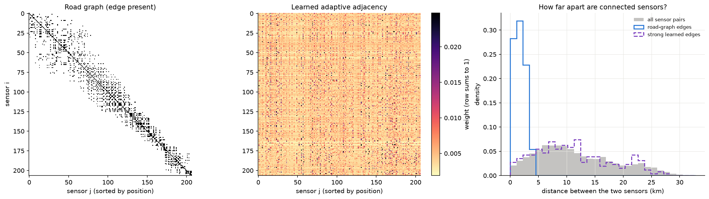

The adaptive adjacency did not rediscover the road graph. It is close to uniform: the median row spreads its weight over the equivalent of 183 of the 207 sensors, and 93.0% of the weight sits on pairs that are not road-graph edges (such pairs are 93.9% of all pairs). Of the 227 strongest learned edges only 7% are road edges. Their median length is 10.2 km, the same as for random sensor pairs (10.3 km) and far from the 1.7 km of road edges. The 15 strongest edges are listed in [`adaptive_top_edges.csv`](figures/adaptive_top_edges.csv).

So what this term adds is mostly a network-wide average plus a few long-range links between sensors that behave alike. Without the `fixed` and `adaptive` runs we cannot say how much it contributes to the 0.55 mph graph gain.

## 10. Cost

| model | parameters | max epochs | epochs trained | best epoch | best val MAE | sec / epoch | train time (min) | inference (s) | LR cuts |
|---|---|---|---|---|---|---|---|---|---|
| GRU | 51,340 | 40 | 40 | 40 | 3.249 | 27.3 | 18.2 | 3.8 | 2 |
| GWN no-graph | 247,724 | 48 | 48 | 41 | 3.234 | 65.8 | 52.6 | 4.9 | 4 |
| GWN full | 301,016 | 48 | 36 | 28 | 2.781 | 117.5 | 70.5 | 10.7 | 2 |

Training times are wall-clock on an Apple M3 Pro (MPS). Inference time is for all 6,832 test windows, measured with the same code while nothing else was using the GPU. The graph is what costs time: per epoch, GWN full takes 1.8 times as long as GWN no-graph and 4.3 times as long as the GRU, because every layer multiplies the 207-sensor feature map by three adjacency matrices twice. For a 0.57 mph (16%) lower MAE over all horizons, we pay 3.9 times the GRU's training time.

## 11. Limitations
* **One seed.** Each Graph WaveNet model was trained once (seed 42). The 0.55 mph graph effect is far above the seed spread we measured for the GRU in CI2 (at most 0.008 mph), but we have not measured Graph WaveNet's own seed spread.
* **Shorter training than the paper.** 48 epochs at most, against 100 in the paper. The full model stopped early, so this probably cost little, but we did not check.
* **The ablation removes all graph structure at once.** We did not run fixed-only, adaptive-only or a shuffled graph, so we cannot say how much of the gain needs the real road graph. CI2 planned the adaptive-only run, and it is still open.
* **The adaptive adjacency ties the model to these 207 sensors.** Its two embedding tables have one row per sensor, so the trained model cannot be applied to another sensor set or a new sensor without retraining. The GRU and the fixed-graph variant do not have this problem. This matters for any transfer experiment.
* **Dropout differs between the GRU (0.1) and Graph WaveNet (0.3).** The no-graph ablation shares Graph WaveNet's dropout, so the graph-vs-architecture split is not affected, but the architecture step (GRU → GWN no-graph) changes dropout too.
* **Selection effects.** The CI2 events and the CI2 worst-10 sensors were chosen using the GRU's errors. We report GWN full vs GWN no-graph for those, and treat GRU vs GWN there as descriptive only.
* **One test month.** The test split is June 2012 and includes a network outage on 16–18 June.
* **Predictions are not bounded.** GWN full's lowest test prediction is −3.9 mph.

## 12. Plan for the final
What the failure analysis implies:
1. **Separate the two graphs.** Train `--graph-mode fixed` and `--graph-mode adaptive` (the code is already there, about 1 to 1.5 hours each). If the fixed graph alone keeps most of the gain, we can drop the adaptive term and get a model that is not tied to these sensors.
2. **Seeds.** Seeds 0 / 1 / 2 for `gwnet_full` and `gwnet_nograph`, reported as mean ± std like CI2 §8.
3. **Unusual slowdowns.** The remaining large errors are slowdowns far below the typical profile (§8.2). One cheap thing to try is giving the model the historical-average speed for the target times as an extra input, so it can tell "slow as usual" from "slow and unusual". Cases (d) and (e) are the test cases for this.
4. **Whole-network outages.** Fall back to the historical average when more than 90% of the input is missing, which is where all neural models lose to it (§7.3).
5. **Optional extension: transfer to PEMS-BAY.** Train on METR-LA and test on PEMS-BAY with the fixed-graph model, which is the only variant that can transfer (§11). We will only do this if items 1 and 2 are finished.

## References
* Wu, Z., Pan, S., Long, G., Jiang, J., Zhang, C. *Graph WaveNet for Deep Spatial-Temporal Graph Modeling.* IJCAI 2019. arXiv:1906.00121. METR-LA results in Table 2.
* Official Graph WaveNet code: [github.com/nnzhan/Graph-WaveNet](https://github.com/nnzhan/Graph-WaveNet), MIT license, Copyright (c) 2019 Zonghan Wu. Our `src/models/gwnet.py` is adapted from its `model.py`.
* Li, Y., Yu, R., Shahabi, C., Liu, Y. *Diffusion Convolutional Recurrent Neural Network: Data-Driven Traffic Forecasting.* ICLR 2018. Source of the METR-LA data and `adj_METR-LA.pkl`.
* van den Oord, A. et al. *WaveNet: A Generative Model for Raw Audio.* arXiv:1609.03499, 2016.
